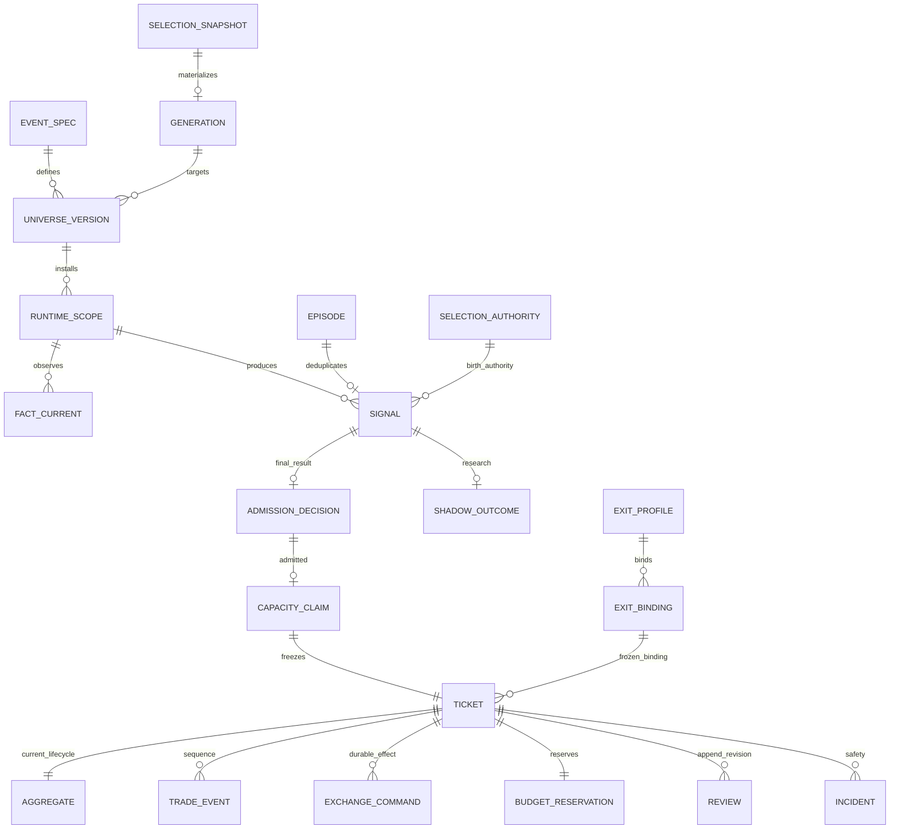
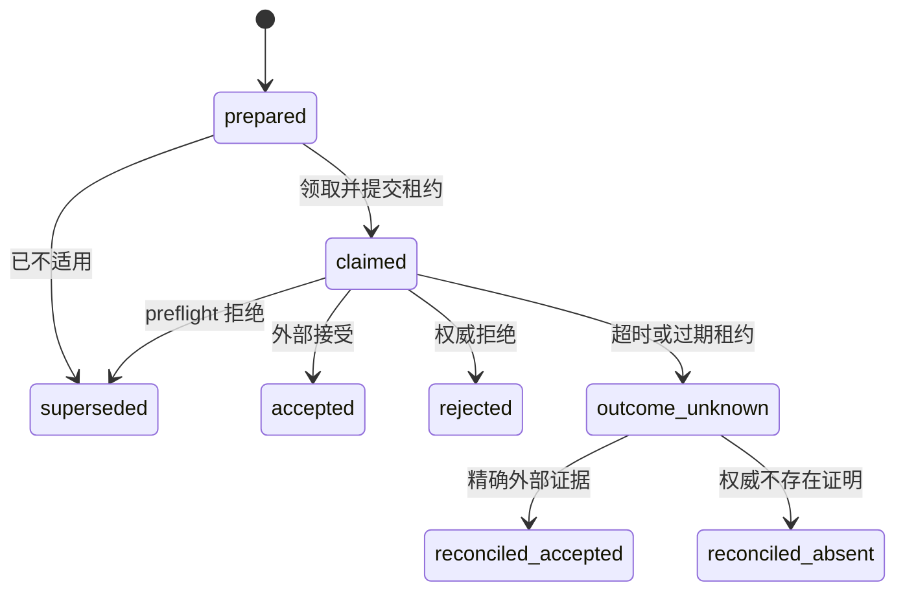
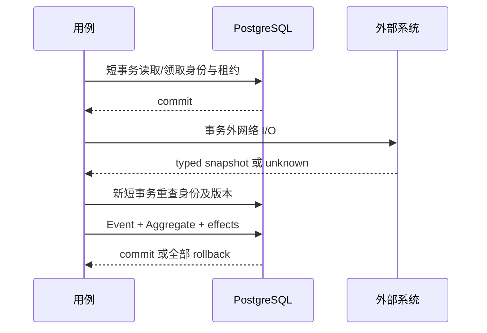

# 数据库状态、身份与事务模型

> **定位：解释性知识库** · [知识地图](README.md)。本页解释 tracked schema，不是生产数据导出；当前生产 schema 和运行快照见 [MAIN_CONTROL_ROADMAP.md](../current/MAIN_CONTROL_ROADMAP.md)。

## 模型权威与存储约定

**表定义来自 `pg_models.py`，实际安装和演进来自单一 Alembic 前向链。**当前源码的 `CURRENT_SCHEMA_REVISION` 是 `0012_generic_signal_path_v1`；这是代码身份，不能直接推断服务器安装情况。（来源：[pg_models](../../src/trading_kernel/infrastructure/pg_models.py)、[runtime_identity](../../src/trading_kernel/infrastructure/runtime_identity.py)、[Alembic env](../../migrations/trading_kernel/env.py)）

1. **current** 通常是可更新投影，不能被当作完整历史。
2. **events / snapshots / frozen identity** 保存发生过的事实或签发依据；命令记录有持久化身份及可推进状态，不能把“append-only 语义”误读为每个表行从不更新。
3. 金融列常用 **NUMERIC(38,18)**；选币 Decimal 列使用无固定 scale 的 Numeric。Python 边界用 Decimal，时间使用 epoch 毫秒，HTTP 按接口序列化。
4. SQLAlchemy Core 的 metadata 是 schema 描述，领域层的冻结 Pydantic 模型不是 ORM 行对象。

来源：[pg_models 类型定义](../../src/trading_kernel/infrastructure/pg_models.py)、[domain/ticket](../../src/trading_kernel/domain/ticket.py)、[pg_repositories](../../src/trading_kernel/infrastructure/pg_repositories.py)。

## 核心关系图



这是**业务身份关系图**，不是全库物理外键图；并非每条关联都由 SQL ForeignKey 实现。例如未准入 Signal 没有 Claim，历史终态行可以缺少后来新增的绑定来源。精确约束以 metadata、migration 与 repository 校验共同判断。（来源：[pg_models](../../src/trading_kernel/infrastructure/pg_models.py)、[issue_ready_signal](../../src/trading_kernel/application/issue_ready_signal.py)、[pg_repositories](../../src/trading_kernel/infrastructure/pg_repositories.py)）

## 主链路数据字典

| 表 | 主键 / 关联身份 | 核心字段及含义 | 主要写入者 |
| --- | --- | --- | --- |
| **brc_runtime_scopes_current** | runtime_scope_id；Event/Universe/instrument/side | scope_version、observation_generation、warming、观察 due 与租约 | Universe 仓储、Observation |
| **brc_facts_current** | fact_current_id；scope + fact_definition 唯一 | value、satisfied、observed_at、valid_until、projection_version | observe_strategy_scope |
| **brc_exposure_episode_current** | episode_domain_key | armed/triggered/rebase 状态、Episode、最近观察收盘 | 观察与 rebase |
| **brc_signal_events** | signal_event_id；exposure_episode_id 唯一 | 冻结 Scope/Universe/Authority、fact_digest、发生与失效时间 | ingest_signal |
| **brc_signal_fact_snapshots** | signal_event_id + fact_definition_id | 冻结事实值、角色、时效与投影版本 | ingest_signal |
| **brc_readiness_current** | runtime_scope_id | readiness_state、first_blocker、signal_event_id、fact_summary | 观察、准入 |
| **brc_admission_decisions** | admission_decision_id；signal_event_id 唯一 | decision_status、first_blocker、candidate_set、portfolio_usage、可空 Claim/Ticket | issue_ready_signal |
| **brc_capacity_claims** | capacity_claim_id；ticket / signal 关联 | 账户快照摘要、预算、规则版本、当前绑定、政策与域事实 | issue_ticket |
| **brc_trade_tickets** | ticket_id；signal_event_id 唯一 | 冻结执行合同、active_netting_domain_key、退出绑定、terminal_at | issue_ticket；闭合释放活动域 |
| **brc_entry_lane_current** | lane_id | 当前 ticket/signal、status、owner、lease、version | Entry admission 仓储与 reducer effects |
| **brc_budget_reservations** | budget_reservation_id；ticket_id 唯一 | reserved_notional/risk/margin、status、released_at | 签发、闭合 effects |
| **brc_account_exposure_current** | venue_id + account_id | gross_risk_at_stop、reserved_margin、active_ticket_count | 资金预留和释放事务 |
| **brc_trade_aggregates** | ticket_id | status、version、last_event_sequence、position_qty、保护订单身份、review_id、各 work_kind due | commit_reduction 与调度仓储 |
| **brc_trade_events** | event_id；ticket_id + sequence 唯一 | event_type、payload、occurred_at_ms | commit_reduction |
| **brc_exchange_commands** | command_id；ticket + kind + generation 唯一 | 精确订单身份、payload、status、claim_owner、lease、result | UoW effects、dispatcher、unknown recovery |
| **brc_positions_current** | netting_domain_key | ticket、quantity、均价、清算价可用性、observed_at | reconcile_ticket |
| **brc_runtime_incidents** | incident_id | kind、status、first_blocker、entry_block_scope/key | reducer effects、fence、恢复用例 |
| **brc_trade_reviews** | review_id；ticket + revision 唯一 | metrics、decision_impact、supersedes_review_id | record/revise_trade_review |
| **brc_monitor_current / events** | monitor_key / monitor_event_id | Owner 可读状态和事件；终态使用 `owner:ticket:<ticket_id>` | project_owner_state、健康监控 |
| **brc_shadow_outcomes_current** | shadow_outcome_id；signal_event_id 唯一 | source_kind、evaluation_kind、冻结输入、结果和不可用原因 | 研究 admission 与 projector |

以上字段均可在 [pg_models](../../src/trading_kernel/infrastructure/pg_models.py)找到；对象到持久化的入口为 [PostgresKernelUnitOfWork](../../src/trading_kernel/infrastructure/pg_unit_of_work.py#L115)、[PostgresSignalRepository](../../src/trading_kernel/infrastructure/pg_signal_repository.py#L116) 和 [pg_repositories](../../src/trading_kernel/infrastructure/pg_repositories.py)。

## 选币与 Owner 的状态族

| 状态族 | 主要表 | 需要一起看的版本 / 身份 |
| --- | --- | --- |
| **Registry / 产品** | strategy_groups、strategy_versions、event_specs、fact_definitions、event_required_facts、instruments、instrument_product_profiles、event_product_compatibility | 精确 Event 与 RuntimeProfile；这里及下文省略共同 `brc_` 前缀 |
| **Policy / Control** | owner_policy_current/events、strategy_entry_controls_current/events、owner_authorizations | policy_version、control_version、request_digest、idempotency_key |
| **Owner Operation** | owner_control_operations_current、owner_control_operation_events | authorization_id、operation version、目标集合与 snapshot_digest |
| **Universe / 认证** | strategy_universe_versions/members/current、instrument_certification_current/batches/batch_members | Event、Universe digest、certified commit/schema、租约、有效期 |
| **Selection** | instrument_selection_specs/jobs_current/attempts/snapshots/member_decisions；generic_dynamic_selection_specs_v1、orb_session_selection_specs_v1 | spec、epoch、period、来源摘要、Job lease 与 attempt |
| **Materialization / Vacuum** | strategy_universe_materialization_generations/targets/events、strategy_entry_vacuums_current/events | generation、lease_epoch、fence、drain、目标版本 |
| **Authority / Gap** | selection_session_authorities、selection_authority_current/event_bindings、selection_authority_gap_audits_current/events、strategy_trigger_suppressions | authority、当前指针、proof、允许收盘及 suppression |
| **Comparison / rollback** | comparison_universe_definitions/members、comparison_binding_current、comparative_projection_current、strategy_selection_rollback_baselines、selection_rollback_baseline_events、materialization_generation_event_baselines | 比较 revision、旧基础和 rebase 证据 |
| **ExitProfile** | exit_policies、event_exit_profile_bindings/current/events | profile hash、binding hash、projection_version |
| **Runtime / research** | runtime_capabilities_current、runtime_release_compatibility_facts、schema_metadata、research_collection_control/events/daily | 认证身份、软件兼容事实、研究配额与覆盖计数 |

来源：[pg_models](../../src/trading_kernel/infrastructure/pg_models.py)、[selection repository](../../src/trading_kernel/infrastructure/pg_instrument_selection_repository.py)、[Owner read repository](../../src/trading_kernel/infrastructure/pg_owner_read_repository.py)。本表按职责分组，不声称“所有类似后缀表都具有相同可变性”。

## 状态与不变量由谁保证

### Command 状态机



图描述常见路径，具体 kind 的恢复事件与可重试规则见 [commands](../../src/trading_kernel/domain/commands.py)和 [recover_unknown_command](../../src/trading_kernel/application/recover_unknown_command.py)。**Claimed 租约过期不是直接回到 prepared**，仓储会持久化未知结果。（来源：[record_expired_claim_unknown](../../src/trading_kernel/infrastructure/pg_repositories.py#L1090)）

### 防重与并发控制

| 不变量 | 数据库或应用措施 | 证据 |
| --- | --- | --- |
| 一次机会最多一个 Signal/Ticket | Episode 唯一 Signal；Signal 唯一 Ticket；确定性身份 | [pg_models](../../src/trading_kernel/infrastructure/pg_models.py)、[producer](../../src/trading_kernel/application/produce_strategy_signal.py) |
| 同域最多一个活动 Ticket | active_netting_domain_key 唯一；闭合释放活动键 | [PostgresTicketRepository](../../src/trading_kernel/infrastructure/pg_repositories.py#L254) |
| 新 ENTRY 串行、组合占用原子 | lane 与账户 exposure 锁；签发事务内重查 | [issue_ticket](../../src/trading_kernel/application/issue_ticket.py#L91) |
| 聚合事件不能覆盖并发结果 | expected_version、连续 sequence、CAS | [commit_reduction](../../src/trading_kernel/infrastructure/pg_unit_of_work.py#L187) |
| 命令不重复生成身份 | command/idempotency/client identity 唯一；ENTRY generation 限制 | [commands](../../src/trading_kernel/domain/commands.py)、[pg_models](../../src/trading_kernel/infrastructure/pg_models.py) |
| Review 可追溯且当前值唯一 | revision/supersedes 唯一；Aggregate 指针 | [revise_trade_review](../../src/trading_kernel/application/settle_ticket.py#L117) |

## 事务边界

**PostgresKernelUnitOfWork 正常退出提交，异常退出回滚。** `commit_reduction` 在事务中追加 Event、CAS 更新 Aggregate、物化 Command/Incident/资源 effects；终态 Owner 投影失败会回滚整个转移。（来源：[UoW](../../src/trading_kernel/infrastructure/pg_unit_of_work.py#L115)、[Owner projection 集成测试](../../tests/trading_kernel/integration/test_owner_projection.py)）



### 闭合不是删除历史

**ReconciliationMatched** 在确认清理完成后释放资金与活动域，并进入 settlement_pending；**BudgetSettled** 推到 review_pending；**ReviewRecorded** 推到 terminal 并物化 Owner 状态。因此“资金已释放”“Ticket 已终态”“经济指标完整”是可分别观察的事实。（来源：[reduce_event](../../src/trading_kernel/domain/reducer.py#L124)、[settle_ticket](../../src/trading_kernel/application/settle_ticket.py)）

## 按身份读取的本地查询示例

以下为**解释性 SQL**，仅 SELECT，不表示已在生产执行；参数需由持有授权的只读工具绑定，不把示例拼成运行输入。

```sql
-- 从 Signal 找最终准入与 Ticket；未作最终决策时 LEFT JOIN 结果可为空。
SELECT s.signal_event_id, s.exposure_episode_id, s.runtime_scope_id,
       d.decision_status, d.first_blocker, d.ticket_id
FROM brc_signal_events AS s
LEFT JOIN brc_admission_decisions AS d ON d.signal_event_id = s.signal_event_id
WHERE s.signal_event_id = :signal_event_id;

-- 从 Ticket 找当前状态与精确命令序列，不做全历史扫描。
SELECT ticket_id, status, version, last_event_sequence, review_id
FROM brc_trade_aggregates WHERE ticket_id = :ticket_id;
SELECT command_id, command_kind, generation, status, venue_client_order_id
FROM brc_exchange_commands WHERE ticket_id = :ticket_id
ORDER BY created_at_ms, command_id LIMIT 100;
```

查询有界不代表必须手工 SQL 排障；优先使用 [Owner signals 接口](../../src/trading_kernel/interfaces/owner_console_http/routes/signals.py)与[Owner 查询仓储](../../src/trading_kernel/infrastructure/pg_owner_read_repository.py)。[只读 Signal 路径接口](../../src/trading_kernel/interfaces/read_signal_path.py)以 Shadow 行为起点，只适合已有研究采集的 Signal；空结果不表示 Signal 不存在。本地验证和 schema 约束测试见[代码与测试索引](CODE_AND_TEST_INDEX.md)。
