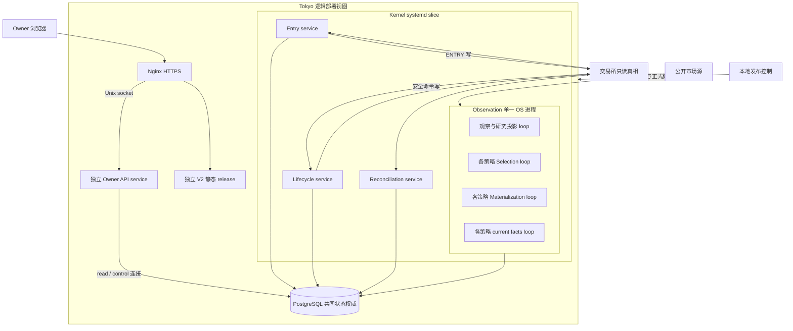
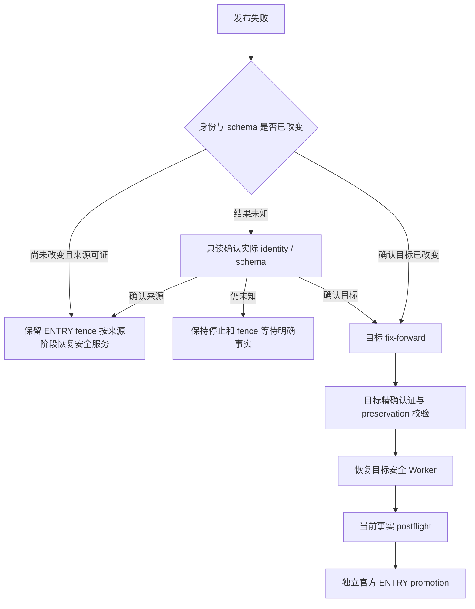

# 部署拓扑、发布与故障恢复

> **定位：解释性知识库** · [知识地图](README.md)。本页解释受版本管理的配置及流程；机器现状、部署 SHA、标签和验收结果只查 [MAIN_CONTROL_ROADMAP.md](../current/MAIN_CONTROL_ROADMAP.md)，执行操作前仍需刷新直接事实。

## 拓扑：进程与逻辑角色分别看



**这张图表达仓库声明的逻辑部署关系，没有声称本轮核对了机器上的进程、数据库安装方式或网络端点。**共同数据库的具体服务位置以机器配置为准。（来源：[systemd Observation](../../deploy/systemd/brc-trading-kernel-observation-worker.service)、[API service](../../deploy/owner-console/systemd/brc-owner-console-api.service)、[Nginx](../../deploy/owner-console/nginx/owner-console.locations.conf)、[启动装配](../../scripts/trading_kernel/run_observation_worker_once.py#L97)）

## 服务、入口与配置责任

| 服务 / 组件 | 代码或配置入口 | 配置与恢复边界 |
| --- | --- | --- |
| **Observation** | [service](../../deploy/systemd/brc-trading-kernel-observation-worker.service)、[脚本](../../scripts/trading_kernel/run_observation_worker_once.py) | 常驻运行；scope/Job/Generation 有独立租约；进程内部多个 loop |
| **Entry** | [service](../../deploy/systemd/brc-trading-kernel-entry-worker.service)、[脚本](../../scripts/trading_kernel/run_command_worker_once.py) | 命令与 lane 持久化；当前运行身份和账户事实仍需校验 |
| **Lifecycle** | [service](../../deploy/systemd/brc-trading-kernel-lifecycle-worker.service)、[use case](../../src/trading_kernel/interfaces/lifecycle_worker.py) | 既有安全工作；不能用暂停新 ENTRY 替代生命周期运行 |
| **Reconciliation** | [service](../../deploy/systemd/brc-trading-kernel-reconciliation-worker.service)、[脚本](../../scripts/trading_kernel/run_reconciliation_worker_once.py) | unknown / critical / housekeeping 与 due 调度 |
| **Owner API** | [service](../../deploy/owner-console/systemd/brc-owner-console-api.service)、[run_api](../../scripts/owner_console/run_api.py) | 独立目录、venv、socket、read/control DB role；认证凭据由 systemd credential 载入 |
| **V2 静态站** | [发布脚本](../../scripts/owner_console/deploy_release.py)、[frontend package](../../frontend/owner-console-v2/package.json) | 独立 dist release 与 symlink，不随意重启 Kernel |

**Kernel 环境变量**主要包括数据库 URL、runtime commit、schema revision、Worker identity、lease/timeout、market/venue factory；真实值不写入知识库。市场、账户、密钥等加载边界见 [production_runtime](../../src/trading_kernel/infrastructure/production_runtime.py)，这里只记录配置名称与责任，不读取 `.env` 或 credential 内容。

## 发布先分类

| 级别 | 改动边界 | 应用路径 | 主要验证与恢复 |
| --- | --- | --- | --- |
| **R0** | 文档、测试等 | 本地评审与提交 | 文档检查与适当测试；无需生产动作 |
| **R1** | V2 静态前端 | Owner deploy `static` | 精确构建/资源 hash；失败恢复静态 symlink |
| **R2** | Owner API / auth / 展示查询 | Owner deploy `api` | 精确 API certification、schema 与 healthz；仅恢复 API release/unit |
| **R3** | 同 schema Kernel 行为 | Kernel regular release | flat、当前事实、认证与运行身份；按失败阶段 fence / fix-forward |
| **R4** | Schema / Registry / Policy / authority | preservation-gated compatible upgrade | 停写、flat、精确来源、保留证明、前向迁移与目标恢复 |

来源：[classify_changed_paths](../../scripts/classify_release.py#L83)、[部署契约](../current/TOKYO_RUNTIME_DEPLOYMENT_CONTRACT.md)、[Owner 发布实现](../../scripts/owner_console/deploy_release.py#L111)。混合改动按最高级别，不能仅因有文档文件便归为 R0。

## Kernel 正式发布顺序

### 同 schema 发布

1. **冻结候选及精确认证**：认证绑定 commit、schema、Registry、Policy 和命令集；代码或身份改变使旧认证不能复用。
2. **刷新 preflight**：当前数据库与交易所 flat/无残单、当前币池、账户模式、杠杆、现有 writer 清单；不能用本地旧报告替代。
3. **停止写者并 fence**：验证服务确实停止、数据库写者已隔离；按代码盘点包括需要停的 Owner API 写者。
4. **停写后再次读取来源**：保存需要保留的当前状态，校验来源身份没有漂移。
5. **正式轮换 runtime identity 与 release**：未知提交结果不能直接启动旧写者。
6. **先启动 Lifecycle/Reconciliation**：刷新认证、验证保留状态，再启动可执行 Selection 的 Observation。
7. **running-target postflight**：重核当前 identity、controls、membership 与外部安全事实。ENTRY 通过独立 promotion 恢复，不由软件发布隐式打开。

来源：[deploy_tokyo_release](../../scripts/trading_kernel/deploy_tokyo_release.py#L321)、[writer 检查测试](../../tests/trading_kernel/unit/test_deploy_tokyo_release.py#L2331)、[promote_entry](../../scripts/trading_kernel/promote_entry.py)。

### schema 前向升级

**只能在停止写者、flat、来源精确且保留证明通过后执行**。本系统不支持携带活动仓位跨 schema、双写、旧 schema reader 或 downgrade。初次无备份重建是历史授权，不是未来升级模板。（现行契约：[迁移规则](../../AGENTS.md)、[部署契约](../current/TOKYO_RUNTIME_DEPLOYMENT_CONTRACT.md)）

源码入口：[兼容升级](../../scripts/trading_kernel/deploy_tokyo_release.py#L538)、[bootstrap_schema](../../scripts/trading_kernel/bootstrap_schema.py)、[migration env](../../migrations/trading_kernel/env.py)。各 revision 的来源与保留谓词不同，不能把 `upgrade head` 当作独立完整生产操作手册。

## 失败阶段决定恢复方向



**回滚不是跨阶段统一动作**：R1/R2 可恢复其独立 symlink；Kernel identity/schema 已轮换后，不能因为界面“失败”就启动旧版本。来源、目标和未知三类事实决定恢复方向。（来源：[部署恢复实现](../../scripts/trading_kernel/deploy_tokyo_release.py)、[unknown identity 测试](../../tests/trading_kernel/unit/test_deploy_tokyo_release.py#L2342)、[目标 fix-forward 测试](../../tests/trading_kernel/unit/test_deploy_tokyo_release.py#L565)）

## Worker 重启如何继续

1. **正常停止**：常驻 loop 处理 SIGINT/SIGTERM 并退出；systemd restart-on-failure。多个逻辑 loop 在 Observation 进程中独立调度，并隔离单个 tick 异常。（来源：[worker_process](../../src/trading_kernel/interfaces/worker_process.py)）
2. **持久化恢复**：Scope、Command、Generation、Operation 的 due/lease/版本在 PostgreSQL；内存游标不赋予交易权限。
3. **租约到期**：重新领取前验证代次或 lease epoch，命令写结果不明时进入 unknown，不能把 lease 过期当作无外部副作用。（来源：[pg_repositories](../../src/trading_kernel/infrastructure/pg_repositories.py)、[pg_signal_repository](../../src/trading_kernel/infrastructure/pg_signal_repository.py)）
4. **身份不符**：旧 Worker 的 commit/schema 不能执行外部变更；隔离问题写者并由认证身份恢复，不修改 fence 来“让它跑起来”。（来源：[runtime_fence](../../src/trading_kernel/application/runtime_fence.py)）

## 故障诊断手册：先找哪条证据

**以下是只读取证顺序，不是自动执行生产变更的指令。**

| 症状 | 按顺序查证 | 定位实现 | 禁止用来代替证据 |
| --- | --- | --- | --- |
| 有 Signal 没 Ticket | Signal 冻结身份 → Readiness → Decision → lane → 账户快照 | [Entry](../../src/trading_kernel/interfaces/entry_worker.py)、[read_signal_path](../../src/trading_kernel/interfaces/read_signal_path.py) | 旧图表、另一个币种的 readiness |
| Snapshot 完成未激活 | epoch/pending → Job → Generation/Vacuum → 认证/预热 → proof/current | [selection runtime](../../src/trading_kernel/interfaces/selection_runtime_worker.py) | 只看 selected_count |
| 命令卡住 | 精确 Command → 租约及 status → venue client ID/namespace → truth | [unknown recovery](../../src/trading_kernel/application/recover_unknown_command.py) | 再发一张订单试探 |
| 已平仓未终态 | 外部 flat → 自有余单 → unknown → Aggregate → settlement/review | [Reconciliation](../../src/trading_kernel/interfaces/reconciliation_worker.py) | 手动改 terminal 或释放预算 |
| 服务 active 但没进度 | commit/schema fence → due/lease → tick_failed → retry/backlog | [reconciliation_health](../../src/trading_kernel/application/reconciliation_health.py)、[worker_process](../../src/trading_kernel/interfaces/worker_process.py) | systemd active 单一状态 |
| 控制提交冲突 | expected_version → 幂等键绑定 → snapshot_digest → Operation | [owner_control](../../src/trading_kernel/application/owner_control.py) | 重放旧 TOTP 或改数据库 current |

`read_signal_path` 只关联已有 Shadow 记录的 Signal；普通 Signal 的存在性与 blocker 应以 Owner signals/Readiness/Decision 为准，不能把该研究查询的空结果当作没有信号。

### 可复用的本地只读入口

在仓库根目录可先读 `--help` 确认参数。下列命令需要调用者已配置的只读连接；本知识库没有运行它们访问生产。

```bash
.venv/bin/python scripts/trading_kernel/read_signal_path.py --signal-event-id '<exact-signal-id>'
.venv/bin/python scripts/trading_kernel/read_selection_runtime_status.py \
  --strategy-group-id CPM-RO-001 \
  --selection-spec-id CPM_ABSOLUTE_DIRECTIONAL_EFFICIENCY_V1
```

时区解释：算法 session 以代码的 **UTC** 边界为准，Owner 页面业务时间使用接口声明的时区；不能按本机日期重建 session 身份。

## 验证与操作边界

本页从配置和代码验证流程，针对部署故障、身份未知和重启的本地测试见[代码与测试索引](CODE_AND_TEST_INDEX.md)。本轮没有执行部署、迁移、服务操作或生产控制变更；自然交易验收仍独立于文档交付。
