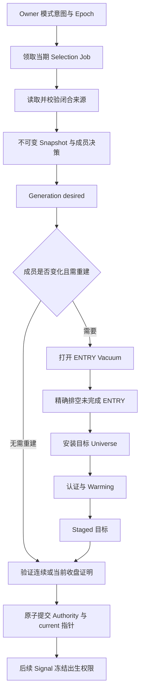
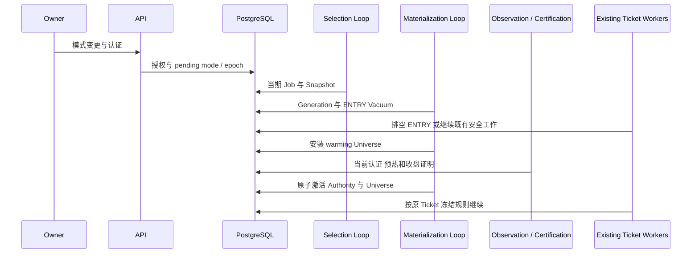

# 动态选币：结果、物化与交易权限

> **定位：解释性知识库** · [知识地图](README.md)。本页不列生产当前成员或激活结果，当前状态见 [MAIN_CONTROL_ROADMAP.md](../current/MAIN_CONTROL_ROADMAP.md)。

## 核心结论与对象边界

**选币计算只产生不可变 Snapshot；物化另行建立 Universe 与 Authority。**拥有排名结果不能直接发 Signal，更不能占用资金。（代码已验证：[run_instrument_selection_once](../../src/trading_kernel/application/run_instrument_selection.py#L106)、[coordinate_selection_materialization_once](../../src/trading_kernel/application/coordinate_selection_materialization.py#L577)）

| 对象 | 负责什么 | 不负责什么 | 实现 |
| --- | --- | --- | --- |
| **Spec** | 固定候选集、特征、资格、排名、时间契约 | 当前启用权限 | [generic_selection_spec](../../src/trading_kernel/domain/generic_selection_spec.py) |
| **Control / Epoch** | Owner 当前模式和待生效意图、版本与代际 | Snapshot 的市场真相 | [SelectionControl](../../src/trading_kernel/domain/selection_authority.py#L297) |
| **Job / Attempt** | 某一期计算的租约、重试与失败记录 | 物化币池 | [runner](../../src/trading_kernel/application/run_instrument_selection.py) |
| **Snapshot** | 当期全部候选资格、特征、排名与选中结果 | 直接更改 current Universe | [GenericSelectionSnapshotV1](../../src/trading_kernel/domain/generic_selection_core.py#L77) |
| **Generation / Vacuum** | 排空未完 ENTRY、安装并预热新币池 | 重写已发行 Ticket | [coordinator](../../src/trading_kernel/application/coordinate_selection_materialization.py)、[Vacuum](../../src/trading_kernel/domain/strategy_entry_vacuum.py) |
| **Authority / current** | 精确 Event、成员、epoch、收盘边界的有效交易权限 | 替代容量与账户校验 | [selection_authority](../../src/trading_kernel/domain/selection_authority.py)、[ingest_signal](../../src/trading_kernel/application/ingest_signal.py) |

## Generic 四族参数及计算路径

**下列数字是代码中的冻结算法参数，不是生产持仓容量。**候选集合为 **Candidate24**，输入为闭合小时窗口，特征值相同时按 instrument identity 稳定排序。（来源：[Spec](../../src/trading_kernel/domain/generic_selection_spec.py#L60)、[纯计算](../../src/trading_kernel/domain/generic_selection_core.py)、[候选常量](../../src/trading_kernel/domain/instrument_selection.py)）

| 策略 | 特征定义标识 | 新入排名 / 保留排名 | 周期 | 窗口 |
| --- | --- | --- | --- | --- |
| CPM | `CPM_ABSOLUTE_DIRECTIONAL_EFFICIENCY_V1` | 16 / 16 | 4h | 25 bars |
| MPG | `MPG_PERSISTENT_LEADERSHIP_SCORE_V1` | 12 / 16 | 1h | 14 bars |
| MI | `MI_POSITIVE_IMPULSE_RECENCY_V0` | 16 / 16 | 1h | 13 bars |
| BRF2 | `BRF2_RESIDUAL_EXTENSION_V0` | 16 / 16 | 4h | 73 bars |

1. [run_selection_runtime_once](../../src/trading_kernel/interfaces/selection_runtime_worker.py#L247) 先检查安装、策略控制、模式、epoch 和当期是否到时。
2. [run_instrument_selection_once](../../src/trading_kernel/application/run_instrument_selection.py#L106) 领取 Job，事务外读取来源，使用同一 cutoff 的完整窗口和资格事实。
3. [generic_selection_core](../../src/trading_kernel/domain/generic_selection_core.py) 校验无缺口、无未来 candle、来源身份一致，按 Decimal 数学计算特征并排序。
4. 合格且排名在 entry_rank 内可以新入；原成员在 retain_rank 内且仍合格可保留。完整成员决策和输入摘要随 Snapshot 持久化。
5. cutoff 为 **t** 时，正常目标生效边界是 **t+1h**，到期为 **t+(cadence+1)h**；最终交易收盘权限仍由 Authority proof 约束。

### 特征数值在衡量什么

| 策略 | 代码计算的含义 | 不能据此推出的结果 |
| --- | --- | --- |
| **CPM** | `abs(末价−首价) / sum(abs(相邻价差))`；衡量 24h 路径的方向效率，路径为零时计算失败 | 绝对值高不表示方向一定向上，做多条件仍由 detector 判断 |
| **MPG** | 在连续六个小时边界计算各币 8h 收益排名，再平均 `(25−rank)/24` | 选币排名不等于当下入场信号，也不改变准入仲裁优先级 |
| **MI** | 12 个小时收益中只保留正值，以由旧到新的 `index/11` 加权后除以正收益总和；无正收益得零 | 分数反映正脉冲时间重心，不是收益率预测 |
| **BRF2** | 用 72h 对数收益对 Candidate24 等权市场收益回归，最近 24h 残差和除以残差平方和的平方根 | 高残差延伸不是自动做空，BRF2 detector 仍需反弹失败；零方差时整个计算失败 |

来源：[compute_generic_selection](../../src/trading_kernel/domain/generic_selection_core.py#L194)、[dynamic_selection_numeric](../../src/trading_kernel/domain/dynamic_selection_numeric.py)。这些是算法解释，**不构成策略收益评价**。

## 从结果到生效

图是 Generic 主路径；空集合、Owner 暂停、来源失败和恢复缺口有专门分支，不能为经过期 generation 续期来绕过门槛。（来源：[coordinator](../../src/trading_kernel/application/coordinate_selection_materialization.py)、[advance_strategy_universe](../../src/trading_kernel/application/advance_strategy_universe.py#L290)、[generic_materialization](../../src/trading_kernel/domain/generic_materialization.py)）

## 切换时序与既有持仓

**Vacuum 不阻断已有 Ticket 生命周期，也不改写其来源。**但它可能要求未完成 ENTRY 精确撤单或等待外部事实，不能解释成“切换币池时一律平掉全部持仓”。（来源：[blocks_existing_ticket_lifecycle](../../src/trading_kernel/domain/strategy_entry_vacuum.py)、[plan_vacuum_ticket_drain](../../src/trading_kernel/application/drain_strategy_entry_vacuum.py#L170)）

## 正常交接与恢复的差别

| 分支 | 判定依据 | 可以消费哪个收盘 | 核查入口 |
| --- | --- | --- | --- |
| **NORMAL_TRANSITION** | 预提交 Snapshot、连续 epoch/比较集合及最新未消费收盘证明 | 满足 proof 的最新收盘；慢几秒不自动构成缺口 | [prepare_generic_current_close_proof](../../src/trading_kernel/application/coordinate_selection_materialization.py#L1869) |
| **RECOVERY_TRANSITION** | 实际失败/权限缺口、恢复 proof 和 Episode/Comparison rebase | 严格未来收盘，不能补吃缺口内信号 | [authority_recovery_rebase](../../src/trading_kernel/domain/authority_recovery_rebase.py)、[timing](../../src/trading_kernel/domain/dynamic_selection_timing.py) |
| **VALID_EMPTY** | 合法计算结果没有可授予成员 | 不授予新 ENTRY 成员 | [coordinator](../../src/trading_kernel/application/coordinate_selection_materialization.py) |
| **Owner paused** | 策略控制暂停 | 不允许通过 fallback 恢复新 ENTRY | [owner_control](../../src/trading_kernel/application/owner_control.py)、[coordinator](../../src/trading_kernel/application/coordinate_selection_materialization.py) |

**过期的恢复授权不能继续等待旧检查点 ARMED。**有效恢复期内仍须保留原观察和 rebase；过期且已形成真实后续收盘缺口时，已有未围栏的 Desired 通过同一 Gap Vacuum 排空、记录源授权和缺口，再继承原围栏安装新目标。新目标只能由现有恢复 proof 授予未来收盘，并重新建立恢复检查点；不清除旧 Episode/事件，也不补吃缺口信号。（来源：[协调器](../../src/trading_kernel/application/coordinate_selection_materialization.py)、[Gap 交接](../../src/trading_kernel/infrastructure/pg_instrument_selection_repository.py)、[真实 PostgreSQL 回归](../../tests/trading_kernel/integration/test_generic_selection_snapshot_repository.py)）

**MPG/MI 的 ComparisonUniverse 独立于 TradableUniverse**，否则选币改变比较基准会改变策略检测本身。比较集合切换有自己的 revision 和 rebase。（来源：[comparison_universe](../../src/trading_kernel/domain/comparison_universe.py)、[project_comparative_universe](../../src/trading_kernel/application/project_comparative_universe.py)）

## SOR-1H 的独立日内分支

**SOR-1H-001 与旧 SOR-001 身份不同**。前者采用独立 ORB session Spec、日 epoch、long/short 配对物化和小时 Gap Audit；不能套用 Generic 单 Event 的全部流程。（来源：[orb_session_selection](../../src/trading_kernel/domain/orb_session_selection.py)、[coordinator](../../src/trading_kernel/application/coordinate_selection_materialization.py)）

1. UTC 00–01 的闭合 opening range 后准备，首个合格小时收盘为 UTC 02，前一 session 的午夜收盘不能获准新入场。
2. 配对切换、rollback baseline、失败后的前一交易基础恢复均要求对应 proof；休眠物理行不自动拥有权限。
3. 当前启动、Owner 授权和交易启用不能由该能力存在性推断。

**全局暂停后 Resume 会重新核验当前授权沿革。**相同 Snapshot 和 LONG/SHORT 币池不能单独证明已恢复；检测到中断后，协调器基于当前 Policy 版本、Owner/Selection 控制、前序 Authority、配对 Universe 和运行身份建立新的 Gap Audit。每次恢复有独立身份，正常重入幂等；审计期间状态漂移、缺失行情或跨过拟授予收盘时拒绝提交。恢复只授予审计完成后的合法小时收盘，旧出生信号不跨越暂停沿革。（来源：[协调器](../../src/trading_kernel/application/coordinate_selection_materialization.py)、[真实 PostgreSQL 回归](../../tests/trading_kernel/integration/test_orb_session_selection_repository.py)）

数值及边界来源：[OrbSessionSelectionSpec](../../src/trading_kernel/domain/orb_session_selection.py#L31)、[SOR-1H detector](../../src/trading_kernel/domain/detectors/sor_1h.py)、[hourly 测试](../../tests/trading_kernel/unit/test_hourly_recovery_clock.py)。

## “已经选币，为什么不能交易”的定位步骤

1. 查 **Control** 的模式、pending、epoch、版本与原授权，不先手工重置 intent。
2. 查本期 **Job/Snapshot** 的截止点、失败原因、来源与成员资格；完成计算不代表物化完成。
3. 查 **Generation/Vacuum**：哪个具体 ENTRY、认证或 warming 阻断推进。
4. 查 **current Universe 与 Authority** 是否精确一致，是否过期、空授权或等待未来收盘。
5. 最后查 Signal 与 Capacity，不能将策略 paused、账户不足等原因归结为选币失败。

相关本地覆盖：[normal authority](../../tests/trading_kernel/unit/test_generic_normal_authority_contract.py)、[recovery proof](../../tests/trading_kernel/unit/test_generic_recovery_grant_proof.py)、[materialization](../../tests/trading_kernel/unit/test_generic_materialization.py)、[数据库原子权限](../../tests/trading_kernel/integration/test_selection_entry_authority_repository.py)。运行记录见[维护与验收](MAINTENANCE.md)。
