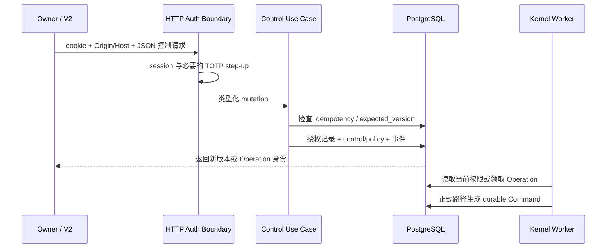
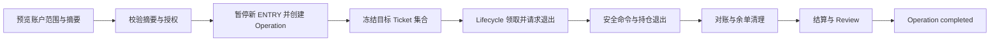

# Owner 控制：从界面到持久化执行

> **定位：解释性知识库** · [知识地图](README.md)。不记录当前 Owner 开关值；当前生产状态见 [MAIN_CONTROL_ROADMAP.md](../current/MAIN_CONTROL_ROADMAP.md)。

## 控制职责与前端入口

**Owner 决定政策范围，系统完成正常运行。**Owner 无需逐单拼装事实或审批每笔范围内交易。（现行契约：[Owner operating model](../current/OWNER_RUNTIME_OPERATING_MODEL.md)）

**代码已验证：当前静态发布选择 Owner Console V2**，其实际页面和 API 应从 [App](../../frontend/owner-console-v2/src/App.tsx)、[Navbar](../../frontend/owner-console-v2/src/components/Navbar.tsx) 和 [controlsApi](../../frontend/owner-console-v2/src/api/controlsApi.ts) 阅读；旧 `frontend/owner-console` 不能用来推定现行交互。（来源：[静态发布实现](../../scripts/owner_console/deploy_release.py)）

### 控制能力对照

| 能力 | HTTP 路径，相对 `/api/owner/v1` | 实际效果 | 认证与后续 |
| --- | --- | --- | --- |
| **全局暂停 ENTRY** | POST `/controls/entry/pause` | 版本化关闭新入场，不终止现有保护 | 已登录、写请求校验；更新 Policy |
| **全局恢复 ENTRY** | POST `/controls/entry/resume` | 通过 scope 恢复检查后允许新入场 | TOTP step-up、expected_version、正式 blocker 检查 |
| **策略暂停/恢复** | POST `/controls/strategies/{id}/pause` 或 `/resume` | 仅改变指定 Group 新入场控制 | pause 为 session；resume 要 step-up；旧 SOR 拒绝恢复 |
| **Dynamic / Static 模式** | POST `/controls/strategies/{id}/selection/dynamic/activate` 或 `/selection/static/activate` | 记录待生效意图；物化随后异步发生 | step-up、版本、周期或 baseline/epoch |
| **退出方案切换** | POST `/controls/strategies/{strategy_group_id}/events/{event_spec_id}/exit-profile` | 改变未来 Claim 的当前绑定 | step-up、精确绑定/语义 hash；已签发 Ticket 保持冻结 |
| **受控全平预览** | POST `/controls/exposure/flatten-all/preview` | 生成账户范围快照和摘要 | 已登录；不直接下单 |
| **受控全平提交** | POST `/controls/exposure/flatten-all` | 关闭新 ENTRY、持久化授权与 Operation、冻结目标 | step-up、确认文字、snapshot_digest、expected_version |
| **操作查询** | GET `/control-operations/{authorization_id}` | 读取持久化进度，不等于提交即完成 | 已登录与控制读取连接 |

接口、路径及校验来源：[controls 路由](../../src/trading_kernel/interfaces/owner_console_http/routes/controls.py)。精确路径以路由装饰器为准，表格不代替 OpenAPI。

## 一次控制请求如何生效

**控制请求不携带交易所写凭据，也不直接调用 venue。**实际 request 校验、全局认证和控制事务分布在 [app](../../src/trading_kernel/interfaces/owner_console_http/app.py#L128)、[auth](../../src/trading_kernel/interfaces/owner_console_http/auth.py#L156)、[routes/controls](../../src/trading_kernel/interfaces/owner_console_http/routes/controls.py) 与 [application/owner_control](../../src/trading_kernel/application/owner_control.py)。

### 并发与幂等

1. **`expected_version`** 防止页面旧状态覆盖新的策略或 Policy 控制。
2. **`idempotency_key`** 绑定请求摘要和目标范围；同键不同请求不能当作安全重试。
3. **授权事实**保留 Owner identity、purpose、认证强度、摘要与时间，不把密码或 TOTP 原值保存到业务授权。
4. **TOTP step-up** 在 HTTP 层验证并防止重放；不能把 application 请求里的强度字符串当成外部认证证明。

来源：[ControlMutationRequest](../../src/trading_kernel/application/owner_control.py#L66)、[set_strategy_entry_state](../../src/trading_kernel/application/owner_control.py#L150)、[set_global_entry_state](../../src/trading_kernel/application/owner_control.py#L244)、[OwnerAuthorization](../../src/trading_kernel/domain/owner_control.py#L56)、[OwnerAuthService](../../src/trading_kernel/interfaces/owner_console_http/auth.py#L156)。

## 为什么暂停后还有动作

**`new_entry_submit_enabled` 只控制新 ENTRY**。保护、退出、对账、结算与 Review 依赖已暴露 Ticket 冻结的安全权限继续执行；关闭新入场不是关闭所有 Worker。（来源：[ENTRY preflight](../../src/trading_kernel/application/revalidate_entry_dispatch.py#L152)、[Lifecycle Worker](../../src/trading_kernel/interfaces/lifecycle_worker.py#L100)、[P0 设计](../current/P0_TRADING_KERNEL_REBUILD_DESIGN.md)）

在数据库中，“配置允许”与“此时有效允许”也不同：Policy 开启之后仍可能被 runtime fence、策略暂停、Vacuum、Authority 到期、账户或容量门槛阻断。读取控制页时要看具体 blocker，而非只看按钮状态。（来源：[read_controls](../../src/trading_kernel/interfaces/owner_console_http/routes/controls.py#L421)、[entry_scope](../../src/trading_kernel/application/owner_console/entry_scope.py)）

## flatten-all 是异步受控操作

1. [preview_flatten_all](../../src/trading_kernel/application/owner_control.py#L713) 按账户跨 RuntimeProfile 列出快照。
2. [begin_flatten_all](../../src/trading_kernel/application/owner_control.py#L763) 校验快照、处理幂等并关闭新 ENTRY；先建立 VALIDATING Operation。
3. [freeze_flatten_targets](../../src/trading_kernel/application/owner_control.py#L836) 在后续事务冻结目标，避免单个长事务跨越执行周期。
4. [consume_pending_flatten_once](../../src/trading_kernel/application/owner_control.py#L954) 由 Lifecycle 调用，生成正式退出请求。
5. [advance_flatten_operation_once](../../src/trading_kernel/application/owner_control.py#L972) 依据目标实际进度推进；遇到问题可以 blocked / needs_intervention，不能把 HTTP 201 当作账户已 flat。

**分析：控制页需要呈现 Operation 的事实进度，而不是用前端倒计时推断平仓成功。**具体页面验证参考 [ControlledFlattenModal](../../frontend/owner-console-v2/src/components/ControlledFlattenModal.tsx) 与 [ControlsFlattenIntegration 测试](../../frontend/owner-console-v2/src/components/ControlsFlattenIntegration.test.tsx)。

## 方向风险偏好 V1

**这是本地已实现的代码能力，部署与激活需独立证据。**Owner 的偏多／中性／偏空
表达 Crypto 新开仓的方向风险意愿，Capacity 采用原政策与附加方向上限中更严格者；
策略观察、维护暂停、选币和已有持仓管理仍各有权威。精确数值与口径归
[实验风险契约](../current/RUNTIME_ORDER_CAPABLE_EXPERIMENT_PROFILE.md)，生产状态归
[MAIN_CONTROL_ROADMAP.md](../current/MAIN_CONTROL_ROADMAP.md)。

| 阅读问题 | 实现入口 | 关键语义 |
| --- | --- | --- |
| 选择怎样变成额度 | [directional_risk](../../src/trading_kernel/domain/directional_risk.py)、[build_capacity_claim](../../src/trading_kernel/application/build_capacity_claim.py) | 精确 Event 范围，只收紧，不扩大基础风险 |
| 怎样保存选择与历史 | [pg_directional_risk_repository](../../src/trading_kernel/infrastructure/pg_directional_risk_repository.py) | 显式 unset、CAS、请求幂等、不可变规则及审计 |
| 切换与发送怎样排序 | [dispatch_exchange_command](../../src/trading_kernel/application/dispatch_exchange_command.py)、[venue_adapter](../../src/trading_kernel/infrastructure/venue_adapter.py) | 共享事务锁、准确命令的最终授权、固定签名窗口 |
| 已成交为何仍在切换中 | [recover_unknown_command](../../src/trading_kernel/application/recover_unknown_command.py)、[recover_directional_transition](../../src/trading_kernel/application/recover_directional_transition.py) | 成交保护立即继续；控制完成还需关闭旧发送授权 |
| 页面怎样处理超时 | [DirectionalRiskCard](../../frontend/owner-console-v2/src/components/overview/DirectionalRiskCard.tsx) | 核验准确请求回执，不用当前选择猜测旧请求是否成功 |

**初始止损风险占用不是实时剩余止损风险。**非终结 Ticket（含未发送者）持续占用
原始风险；浮盈或止损移动不自动产生额度。控制变化也不补发已经拒绝的 Signal。
测试入口为[方向控制集成](../../tests/trading_kernel/integration/test_directional_risk_control.py)、
[真实 HTTP 与受限角色](../../tests/trading_kernel/integration/test_directional_risk_http.py)、
[完整源保全](../../tests/trading_kernel/integration/test_directional_risk_migration.py)。

## 读取、交易历史与经济事实

**查询不是修复入口**。读取 Ticket/Review 不能刷新运行投影；完整窗口收益统计有自己的 readonly transaction、覆盖率和 snapshot fingerprint，不应从一页交易明细加总推断全量。（来源：[pg_owner_read_repository](../../src/trading_kernel/infrastructure/pg_owner_read_repository.py)、[performance](../../src/trading_kernel/application/owner_console/performance.py)、[performance 路由](../../src/trading_kernel/interfaces/owner_console_http/routes/performance.py)）

### 本地验证入口

| 范围 | 测试入口 | 证明边界 |
| --- | --- | --- |
| 状态、幂等、全账户预览 | [test_owner_control](../../tests/trading_kernel/unit/test_owner_control.py) | 用例与模型行为 |
| HTTP 认证、step-up、写请求 | [test_owner_console_http](../../tests/trading_kernel/interfaces/test_owner_console_http.py) | 接口边界，不证明浏览器生产会话 |
| 控制与持久化 | [test_owner_control_plane](../../tests/trading_kernel/integration/test_owner_control_plane.py) | 本地 PostgreSQL 原子性和状态 |
| UI 操作串联 | [V2 集成测试](../../frontend/owner-console-v2/src/components/ControlsFlattenIntegration.test.tsx) | 前端交互，不证明外部交易完成 |

实际执行范围见[维护与验收](MAINTENANCE.md)，本轮不通过点击生产控制来验证文档。
