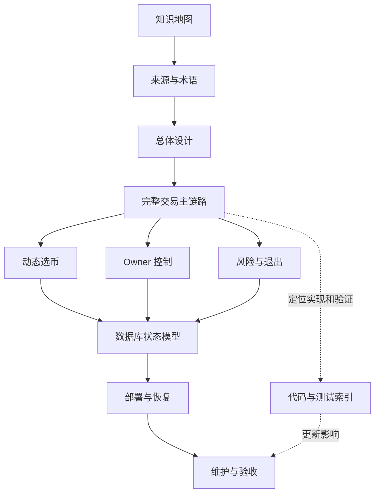

# 项目知识地图

> **定位：解释性知识库**。本目录帮助沿真实代码解释系统行为，不是生产运行输入，也不新增策略、资本或操作授权。生产状态唯一入口：[MAIN_CONTROL_ROADMAP.md](../current/MAIN_CONTROL_ROADMAP.md)。

## 阅读基准与证据边界

**代码基准：`9245a4c1f0eb54ca655c57d5db7706ecb798ac18`**，于 **2026-10-22** 通过远端 `refs/heads/dev` 核对；这是本轮阅读基准，不是生产部署声明。知识库在其后独立维护，提交历史可以追踪资料变化。

1. **代码已验证**：已读取相应实现，结论指向代码入口；代码链接使用仓库相对路径和 Python 定义行号。
2. **现行契约规定**：规范要求，指向 `docs/current` 的责任文档；不据此声称行为已在生产发生。
3. **待核实**：当前缺少直接证明，列入[来源差异清单](SOURCE_AUTHORITY.md)，不补写为既成事实。
4. **测试证据**：区分测试覆盖什么、实际运行什么及未运行什么，记录在[维护与验收](MAINTENANCE.md)。首轮知识库交付没有访问生产；后续全表目录增补只读核对了生产数据库目录，具体证据边界见该记录。

## 从哪里开始读

### 第一遍：建立全局，再贯通交易

| 顺序 | 材料 | 阅读后能够回答 |
| --- | --- | --- |
| 1 | [来源、权威与有效性](SOURCE_AUTHORITY.md) | 哪个来源负责什么，冲突时如何取证 |
| 2 | [术语表](GLOSSARY.md) | Signal、Episode、Claim、Ticket、Command 分别是什么 |
| 3 | [总体设计与模块导航](SYSTEM_OVERVIEW.md) | 软件边界、运行进程、数据和外部系统如何连接 |
| 4 | [一笔交易的完整生命周期](TRADE_LIFECYCLE.md) | 信号如何进入准入、执行、保护及终态闭合 |
| 5 | [代码与测试索引](CODE_AND_TEST_INDEX.md) | 每个结论对应哪个函数和哪种测试 |

### 第二遍：深入专题

| 阶段 | 专题 | 阅读目标 | 前置知识 |
| --- | --- | --- | --- |
| 动态选币 | [DYNAMIC_SELECTION](DYNAMIC_SELECTION.md) | 区分选币结果、物化、Universe 和交易 Authority | 主链路、Signal 冻结身份 |
| Owner 控制 | [OWNER_CONTROLS](OWNER_CONTROLS.md) | 从界面操作追踪到鉴权、数据库和 Worker | Policy、命令持久化 |
| 风险与退出 | [RISK_AND_EXIT](RISK_AND_EXIT.md) | 理解定量、保护、退出及故障处理 | Claim、Aggregate、Reducer |
| 数据库状态 | [DATA_MODEL](DATA_MODEL.md) | 按对象身份、状态和事务追踪事实 | 主链路与三个专题 |
| 全表目录 | [DATABASE_TABLE_CATALOG](DATABASE_TABLE_CATALOG.md) | 逐表查看职责、主要内容、主键、完整字段和维护路径 | 数据库状态模型 |
| 部署与恢复 | [DEPLOYMENT_AND_RECOVERY](DEPLOYMENT_AND_RECOVERY.md) | 区分软件发布、权限恢复和自然交易验收 | 运行身份、持久化恢复 |
| 持续维护 | [MAINTENANCE](MAINTENANCE.md) | 判断资料何时需要更新及如何重新验收 | 上述索引与专题 |

## 知识之间怎样连接

这是**阅读关系图**，不是生产调用图。真实模块调用和运行进程见总体设计；交易时间顺序见主链路。

## 按问题查阅

| 现场问题 | 先看 | 沿哪些对象找证据 |
| --- | --- | --- |
| 有信号却没有 Ticket | [主链路](TRADE_LIFECYCLE.md) | Scope → Signal → Readiness → AdmissionDecision |
| 选币完成但没有激活 | [动态选币](DYNAMIC_SELECTION.md) | Control → Job/Snapshot → Generation → Vacuum → Authority |
| 暂停后为什么还有动作 | [Owner 控制](OWNER_CONTROLS.md) | 新 ENTRY 权限与已暴露 Ticket 的安全工作 |
| 请求超时后会不会重复下单 | [风险与退出](RISK_AND_EXIT.md) | Command 状态、精确订单身份、未知结果恢复 |
| 平仓后为什么还没结束 | [数据模型](DATA_MODEL.md) | 余单 → Reconciliation → Settlement → Review |
| 一共有多少表、每张表存什么 | [全表职责与内容目录](DATABASE_TABLE_CATALOG.md) | 业务表、迁移版本表、运维表分别统计；逐表字段与维护用途 |
| 重启后从哪里继续 | [部署与恢复](DEPLOYMENT_AND_RECOVERY.md) | 运行身份、持久化命令、租约和 due 状态 |

## 完成的含义

**本知识库以“可解释、可定位、可验证、可维护”为验收标准**。完整交易讲解基于代码路径与本地验证；不将某个本地 Ticket 样例称为自然真实交易，也不替代项目的生产验收。具体要求、证据和剩余边界见[维护与验收](MAINTENANCE.md)。
