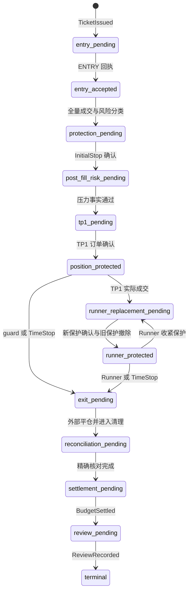

# 风险、保护与退出

> **定位：解释性知识库** · [知识地图](README.md)。数值政策由[实验 Profile](../current/RUNTIME_ORDER_CAPABLE_EXPERIMENT_PROFILE.md)负责，生产生效值与状态见 [MAIN_CONTROL_ROADMAP.md](../current/MAIN_CONTROL_ROADMAP.md)。

## 风险分布在哪些边界

**风险控制跨越观察、Claim、签发、派发和成交后管理**。不能因为某个 Signal ready 或 Claim 曾经合法，就跳过下一阶段的当前事实重查。（来源：[build_capacity_claim](../../src/trading_kernel/application/build_capacity_claim.py#L52)、[issue_ticket](../../src/trading_kernel/application/issue_ticket.py#L97)、[revalidate_entry_dispatch](../../src/trading_kernel/application/revalidate_entry_dispatch.py#L152)）

| 边界 | 输入 | 关键判断 | 拒绝或后续处理 |
| --- | --- | --- | --- |
| Signal / Authority | Registry、Scope、Facts、Universe、权限 | 精确身份、时效、禁用、出生权限 | Readiness blocker，不产生资金权 |
| CapacityClaim | 当前账户、报价、规则、预算、初始止损 | independent sides、margin mode、域空闲、容量、方向及总风险 | 类型化拒绝状态 |
| Ticket 签发 | Claim 与数据库当前 Policy/占用 | 全局 lane、Episode、当前绑定、组合占用、版本 | 原子拒绝或一次性签发 |
| ENTRY preflight | 冻结 Ticket/Claim 与最新账户事实 | 规则与权限未变、域无冲突、风险仍可执行 | supersede / 不写交易所 |
| 成交后风险 | 实际数量、均价、止损与压力事实 | 风险超额、保护方向、Cross margin 压力 | 正常保护、保护后 flatten 或立即 flatten |
| 生命周期 | Ticket 冻结 ExitProfile、市场与订单事实 | TP1、保本、Runner、guards、TimeStop | 持久化安全命令并确认 |

## 仓位如何计算

### 已从代码验证的公式

所有金融量使用 **Decimal**。下列是 [select_capacity_candidate](../../src/trading_kernel/domain/capacity_sizing.py#L172) 的可读展开；数量还必须满足交易所步长、最小量与双腿退出约束。

```text
剩余总止损风险 = max(wallet × gross_stop_fraction − 已占总风险, 0)
剩余方向风险   = max(wallet × directional_fraction − 该方向风险, 0)
本票止损预算   = min(wallet × ticket_stop_fraction, 剩余总止损风险, 剩余方向风险)

当前保证金占用 = max(交易所 total_initial_margin, 内部 reserved_margin)
剩余总保证金   = max(margin_balance × gross_margin_fraction − 当前保证金占用, 0)
本票保证金预算 = min(margin_balance × ticket_margin_fraction, available_margin, 剩余总保证金)

风险数量       = 向下取整至步长(本票止损预算 ÷ |入场参考价 − 初始止损|)
保证金数量     = 向下取整至步长(本票保证金预算 × 固定杠杆 ÷ 入场参考价)
最终数量       = min(风险数量, 保证金数量)
实际计划风险   = 最终数量 × |入场参考价 − 初始止损|
```

1. **杠杆是固定配置事实**，当前代码常量为 **5x**；容量不是为单票自由选择更高杠杆，也不会因风险预算不足自动提高杠杆。（来源：[capacity_sizing](../../src/trading_kernel/domain/capacity_sizing.py)、[fixed-profile preflight 测试](../../tests/trading_kernel/unit/test_entry_dispatch_preflight.py#L339)）
2. **min_materialization_ratio** 设置最小风险预算利用比例；向下取整后不足仍拒绝，不是只要够交易所最小量就下单。
3. **TP1 与 Runner 都要可执行**：按数量分割后，每腿都要满足最小量与保守最小名义约束。
4. **同域禁止叠加**，多空为独立域；同策略同侧上限、Family、全局容量和方向风险仍分别绑定。

来源：[sizing](../../src/trading_kernel/domain/capacity_sizing.py)、[Claim 构造](../../src/trading_kernel/application/build_capacity_claim.py)、[capacity](../../src/trading_kernel/domain/capacity.py)。精确比例只引用 Profile / 当前 Policy，不把示例账户规模当作运行事实。

## 保护和退出状态图



这是**正常路径的缩略状态图**，合并了回执、确认、撤单与重试中间态；不是全部合法转移枚举。完整状态以 [AggregateStatus](../../src/trading_kernel/domain/aggregate.py#L19) 和 [reduce_event](../../src/trading_kernel/domain/reducer.py#L124) 为准。

### 冻结退出规则怎样使用

1. Claim 签发时读取当前 **EventExitBinding**，把 Profile identity、semantic hash 和绑定版本冻结到 Ticket。
2. Lifecycle 按 Ticket 的精确 Profile 读取，而不是每个 tick 跟随 Event 的新绑定。
3. TP1 前检查 Profile 声明的 reclaim/session guards 和 TimeStop；Profile 没声明的条件不能被文档添加成实际行为。
4. TP1 完全成交后计算费用及滑点调整的保本下限；Runner 使用滚动极值与 ATR 规则、旧 watermark 和当前止损决定是否收紧。
5. **替换保护要确认新单，再清理旧单**。旧保护撤单未知属于独立状态，不以“新请求已发送”假定保护链完成。

来源：[maintain_ticket_lifecycle](../../src/trading_kernel/application/maintain_ticket_lifecycle.py#L116)、[calculate_cost_adjusted_break_even](../../src/trading_kernel/domain/exit_policy.py#L628)、[evaluate_profile_runner_exit](../../src/trading_kernel/domain/exit_policy.py#L716)、[Reducer](../../src/trading_kernel/domain/reducer.py#L124)。

## 成交后风险与部分成交

| 情形 | 事实判断 | 实现行为 | 验证入口 |
| --- | --- | --- | --- |
| 全量成交、风险正常 | 实际均价和数量落在冻结预算内 | 安装保护并继续压力校验和正常生命周期 | [post_fill_risk](../../src/trading_kernel/domain/post_fill_risk.py) |
| 实际风险超过计划预算 | 仍在冻结容忍上限内是 TOLERATED_OVERRUN；超过上限是 HARD_OVERRUN | 容忍区间继续 NORMAL；硬超额先保护再 flatten；保护方向错误立即 flatten | [test_post_fill_risk](../../tests/trading_kernel/unit/test_post_fill_risk.py) |
| Cross margin 压力不通过 | 当前整体账户及 instrument facts | 禁止继续正常暴露，进入受控处置 | [cross_margin_stress](../../src/trading_kernel/domain/cross_margin_stress.py)、[全链压力测试](../../tests/trading_kernel/full_chain/test_cross_margin_post_fill_stress.py) |
| 普通部分 ENTRY 成交 | 请求数量未全部成交 | Incident、精确撤余量、确认后 flatten | [fault matrix](../../tests/trading_kernel/full_chain/test_fault_matrix.py#L120) |
| Vacuum 撤单后部分成交 | 撤单已确认、风险 NORMAL 且可分双腿 | 专用 `VacuumPartialRetained` 分支；否则 flatten | [plan_vacuum_ticket_drain](../../src/trading_kernel/application/drain_strategy_entry_vacuum.py#L170)、[D5 差异](SOURCE_AUTHORITY.md) |

**最后一行是当前代码中的专门行为，不能用它解释所有部分成交。**广义契约与该特例是否应统一措辞，仍是明确记录的待裁定项。

## 故障时怎样保留安全语义

| 故障 | 不应推断的事情 | 当前恢复路径 | 代码证据 |
| --- | --- | --- | --- |
| ENTRY authoritative reject | 不能自动另发一代 ENTRY | 终结拒绝，释放其资源 | [commands](../../src/trading_kernel/domain/commands.py)、[reducer](../../src/trading_kernel/domain/reducer.py) |
| 网络超时 / 结果未知 | 不能当作交易所未收到 | 按精确命令身份查询，保留 unknown | [recover_unknown_command](../../src/trading_kernel/application/recover_unknown_command.py#L93) |
| 外部手动平仓 | 不能立刻宣告 Ticket 终态 | external-flat 事件、清理自有保护、对账结算 | [reconcile_ticket](../../src/trading_kernel/application/reconcile_ticket.py#L132) |
| 非本 Kernel 订单 | 不能根据相似币种擅自取消 | 记录归属异常并阻断相应准入 | [unowned order 测试](../../tests/trading_kernel/full_chain/test_ticket_lifecycle.py#L738) |
| Worker 身份不符 | 不能以“为了保护”跳过 fence | 错误写者停止；精确认证写者恢复安全工作 | [runtime_writer_is_certified](../../src/trading_kernel/application/runtime_fence.py#L15) |
| 退出事实过期或缺失 | 不能编造市场判定 | 记录健康/重试并保持现有事实边界 | [lifecycle_facts_health](../../src/trading_kernel/application/lifecycle_facts_health.py)、[Lifecycle Worker](../../src/trading_kernel/interfaces/lifecycle_worker.py) |

## 可读性分析与证据限制

**止损风险预算不是任何市场情形下的实际最大亏损保证。**这里的数学控制以可得报价、冻结止损与成交事实为输入；滑点、缺失经济数据与外部不确定性必须在 Review 中按事实披露。（来源：[post_fill_risk](../../src/trading_kernel/domain/post_fill_risk.py)、[review](../../src/trading_kernel/domain/review.py)；前句为基于实现边界的分析）

本地测试映射及执行记录见[代码与测试索引](CODE_AND_TEST_INDEX.md)和[维护与验收](MAINTENANCE.md)。本页不通过新增真实交易来证明风险流程。
