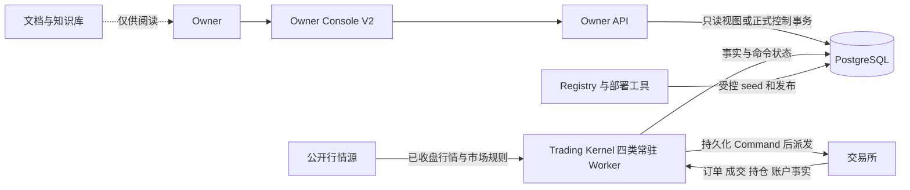
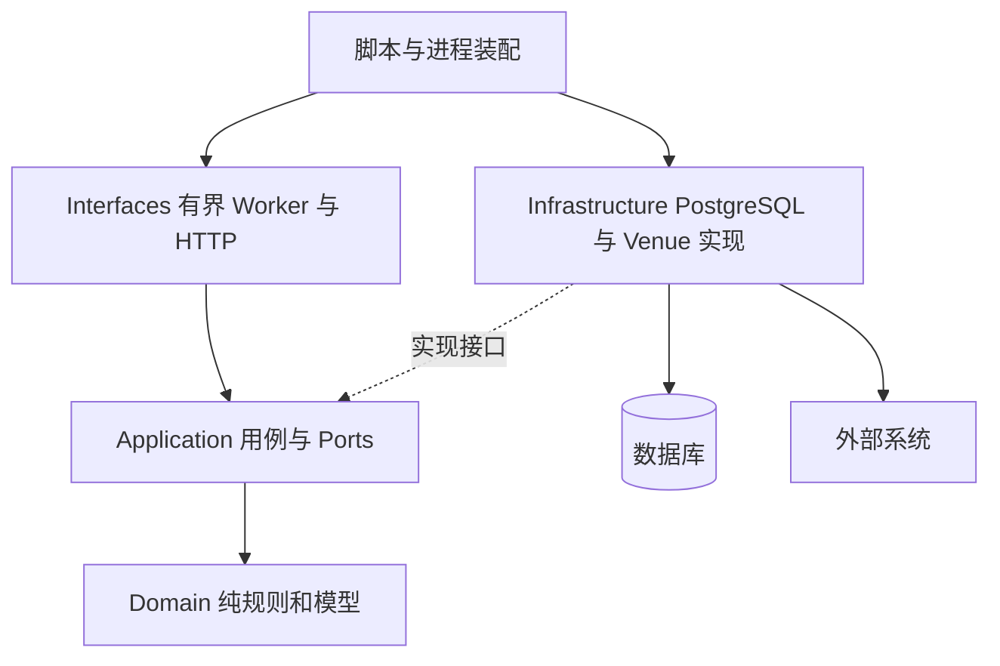
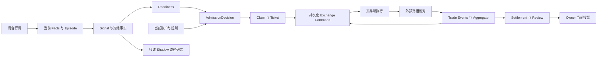

# 总体设计与模块导航

> **定位：解释性知识库** · [知识地图](README.md)。本页描述代码基准的实现，生产部署和启用状态见 [MAIN_CONTROL_ROADMAP.md](../current/MAIN_CONTROL_ROADMAP.md)。

## 目标、边界与非目标

**系统目标是单 Owner、小资本、允许亏损、受边界约束的右尾交易实验**。策略给出机会，Kernel 统一负责资金准入、执行和生命周期；收益稳定性不属于承诺。（现行契约：[实验 Profile](../current/RUNTIME_ORDER_CAPABLE_EXPERIMENT_PROFILE.md)、[评估契约](../current/STRATEGY_EXPERIMENT_EVALUATION_CONTRACT.md)）

**代码已验证：只有一条 Signal→Ticket→Command 执行链。**研究投影、Owner 查询和选币都复用相关对象边界，不能自行建立第二条交易路径。（来源：[issue_ready_signal](../../src/trading_kernel/application/issue_ready_signal.py#L105)、[project_shadow_outcome](../../src/trading_kernel/application/project_shadow_outcome.py)、[owner_control](../../src/trading_kernel/application/owner_control.py)）

## 系统上下文

**API 控制写数据库，Worker 执行交易所命令**；API 的读取与控制连接分离。图中的 Registry/部署工具不是行情轮询的一环。（来源：[dependencies](../../src/trading_kernel/interfaces/owner_console_http/dependencies.py)、[controls 路由](../../src/trading_kernel/interfaces/owner_console_http/routes/controls.py)、[production_runtime](../../src/trading_kernel/infrastructure/production_runtime.py)）

## 软件分层与实际职责

| 层次 | 主要责任 | 从哪里读起 | 边界 |
| --- | --- | --- | --- |
| **Domain** | 身份、策略检测、定量、状态转移、选币数学 | [identities](../../src/trading_kernel/domain/identities.py)、[reducer](../../src/trading_kernel/domain/reducer.py)、[capacity_sizing](../../src/trading_kernel/domain/capacity_sizing.py) | 不做网络、SQL、文件操作 |
| **Application** | 事务内业务编排与跨事务外部读取 | [ports](../../src/trading_kernel/application/ports.py)、[issue_ready_signal](../../src/trading_kernel/application/issue_ready_signal.py)、[dispatch](../../src/trading_kernel/application/dispatch_exchange_command.py) | 依赖类型化端口，不把原始交易所字典传进领域 |
| **Infrastructure** | 数据持久化、事件副作用物化、市场与交易所适配 | [pg_unit_of_work](../../src/trading_kernel/infrastructure/pg_unit_of_work.py)、[venue_adapter](../../src/trading_kernel/infrastructure/venue_adapter.py) | 用精确身份映射外部事实 |
| **Interfaces** | 一次有界工作、HTTP 适配、常驻循环 | [entry_worker](../../src/trading_kernel/interfaces/entry_worker.py)、[worker_process](../../src/trading_kernel/interfaces/worker_process.py) | “一次 tick”不代表冷启动进程 |
| **装配与交付** | 加载工厂、环境参数、启动进程、发布与认证 | [Observation 启动](../../scripts/trading_kernel/run_observation_worker_once.py)、[部署](../../scripts/trading_kernel/deploy_tokyo_release.py) | 运行配置与当前控制事实分别拥有来源 |
| **Owner 前端** | 查询呈现、控制预览、认证交互 | [App](../../frontend/owner-console-v2/src/App.tsx)、[controlsApi](../../frontend/owner-console-v2/src/api/controlsApi.ts) | UI 操作不直接写交易所 |

依赖方向由[架构测试](../../tests/trading_kernel/architecture/test_no_retired_execution.py)和[文件 I/O 审计](../../tests/trading_kernel/architecture/test_runtime_file_io_audit.py)保护；具体本轮执行状态见[验收记录](MAINTENANCE.md)。

## 策略族怎样接入共同内核

**下表是注册语义与代码能力，不是当前启用清单。**所有族均止于 StrategySignal，之后共用资金与执行路径。（来源：[Registry](../../src/trading_kernel/domain/strategy_registry.py#L258)、[producer](../../src/trading_kernel/application/produce_strategy_signal.py#L27)）

| 策略身份 | 方向 / 观察周期 | 核心条件及保护参考 | 代码入口 |
| --- | --- | --- | --- |
| **CPM-RO-001** | Long / 1h | 高周期趋势、回撤回收；pullback low | [cpm](../../src/trading_kernel/domain/detectors/cpm.py) |
| **MPG-001** | Long / 1h | 动量持续与相对领涨；momentum floor | [mpg](../../src/trading_kernel/domain/detectors/mpg.py) |
| **MI-001** | Long / 1h | 脉冲与相对强度；impulse invalidation | [mi](../../src/trading_kernel/domain/detectors/mi.py) |
| **BRF2-001** | Short / 1h | 反弹失败且空头未禁用；rally high | [brf2](../../src/trading_kernel/domain/detectors/brf2.py) |
| **SOR-1H-001** | Long、Short / 1h 入场 | 独立开盘区间突破；已有 Crypto 15m 退出规则 | [sor_1h](../../src/trading_kernel/domain/detectors/sor_1h.py) |
| **SOR-US-EQ-PERP-001** | Long、Short / 15m | TradFi 产品及 session 条件下的区间策略 | [us_equity_sor](../../src/trading_kernel/domain/detectors/us_equity_sor.py) |
| **SOR-001** | 保留旧语义 | 永久禁止新 ENTRY，不能由同名前缀恢复 | [策略准入硬边界](../../src/trading_kernel/application/owner_control.py#L1094) |

策略盈利性、参数优劣及实际启用状态不能由上述结构推出。

## 四类 Worker 的协作

| Worker | 输入与调度依据 | 主要推进内容 | 外部 I/O |
| --- | --- | --- | --- |
| **Observation** | 有租约的 due scope 与选币任务 | 收盘事实、Episode、Signal；选币、物化、预热、研究路径 | 公开行情与选币数据 |
| **Entry** | 已有 ENTRY 命令、空闲 lane、ready 候选 | 行动时快照、Claim、Ticket、ENTRY 派发 | 账户与规则只读；ENTRY 写 |
| **Lifecycle** | 已有安全命令、Owner Operation、受保护 Ticket | Initial Stop、止盈、Runner、退出、受控平仓 | 退出事实只读；非 ENTRY 安全命令写 |
| **Reconciliation** | unknown、critical work、housekeeping due | 外部事实恢复、成交/保护确认、认证、结算与 Review | 只读真相获取；可持久化后续清理命令 |

来源：[Observation](../../src/trading_kernel/interfaces/observation_worker.py#L88)、[Entry](../../src/trading_kernel/interfaces/entry_worker.py#L108)、[Lifecycle](../../src/trading_kernel/interfaces/lifecycle_worker.py#L100)、[Reconciliation](../../src/trading_kernel/interfaces/reconciliation_worker.py#L232)。

**分析：这不是把一个函数拆成四段顺序调用。**Worker 通过数据库的持久化状态、精确键和租约协作；单个进程退出不会把已提交的 Ticket 或 Command 变成内存中的“丢失任务”。Recovery 仍需当前身份和外部事实验证。

## 数据流与一致性

**Ticket 不随当前 Policy、Universe 或退出方案的切换而重写**。它冻结出生身份和执行边界，Aggregate 表达随后实际发生的状态。（来源：[TradeTicket](../../src/trading_kernel/domain/ticket.py#L38)、[TradeAggregate](../../src/trading_kernel/domain/aggregate.py#L105)）

## 为什么采用这些边界

以下是**基于实现的设计分析**：

1. **Signal 与 Claim 分离**：策略可以发现机会，但只有行动时账户事实能给出合法仓位。
2. **不可变 Ticket 与可变 Aggregate 分离**：可以解释“当时允许做什么”与“后来实际发生什么”。
3. **持久化 Command 与网络调用分离**：进程崩溃时仍可按身份恢复未知结果，不靠盲目重发。
4. **串行准入与并行安全维护分离**：保护已有风险时不必等待另一个策略完成观察。
5. **知识库与权威来源分离**：解释可随着代码更新，运行时不会读取文档当作权限。

## 代码阅读顺序

先读 `identities`、`signal`、`ticket`、`aggregate` 的模型，再读 [TRADE_LIFECYCLE](TRADE_LIFECYCLE.md)中的调用链。需要深入每个模块时，按[代码与测试索引](CODE_AND_TEST_INDEX.md)进入具体函数；进程和发布路径见[部署与恢复](DEPLOYMENT_AND_RECOVERY.md)。
