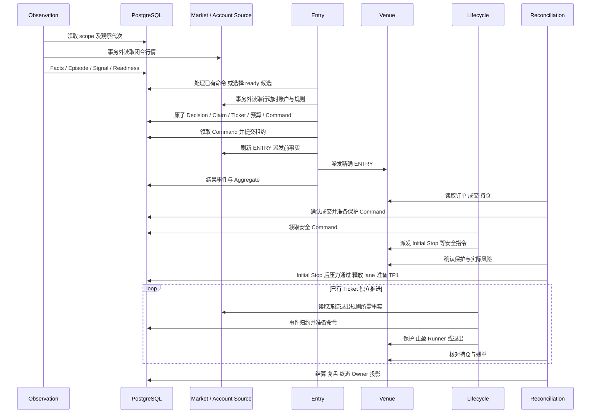
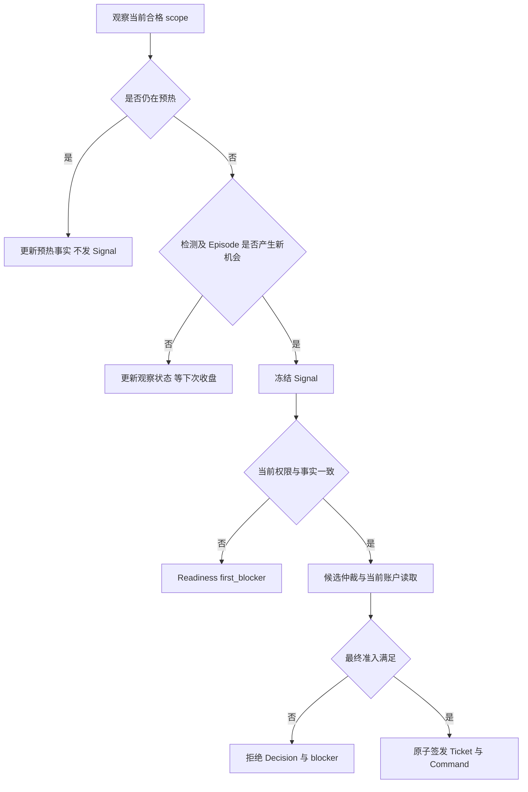
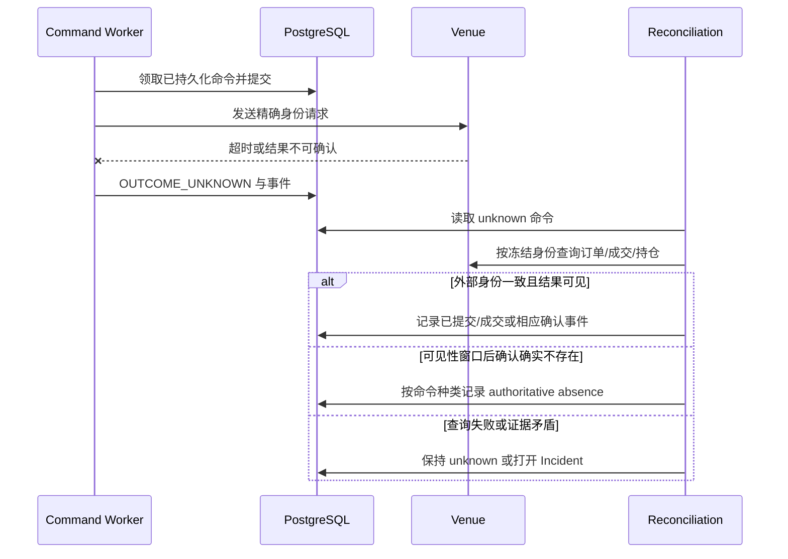

# 一笔交易的完整生命周期

> **定位：解释性知识库** · [知识地图](README.md)。以下是当前代码路径讲解，不是某笔生产交易的复盘；生产证据见 [MAIN_CONTROL_ROADMAP.md](../current/MAIN_CONTROL_ROADMAP.md)。

## 标准链路与阅读对象

**Observation → StrategySignal → Readiness/Authority → CapacityClaim → immutable Ticket → durable Exchange Command → protected lifecycle → reconciliation → settlement → review**。

贯穿全链需要保留 **`runtime_scope_id`、`signal_event_id`、`exposure_episode_id`、`ticket_id`、`command_id`**。发生外部订单后，还要匹配冻结命令的 client order identity、币种、方向和订单命名空间。（来源：[identities](../../src/trading_kernel/domain/identities.py)、[commands](../../src/trading_kernel/domain/commands.py)、[venue_adapter](../../src/trading_kernel/infrastructure/venue_adapter.py)）

## 正常路径：从收盘到终态

| 步骤 | 实际入口与判断 | 读取 / 写入结果 | 在此停止的典型原因 |
| --- | --- | --- | --- |
| 1. 领取观察 | [run_observation_worker_once](../../src/trading_kernel/interfaces/observation_worker.py#L88) 领取 due scope 租约 | 锁定 scope、观察代次和本次收盘 | 无任务、代次被替代 |
| 2. 构造行情与检测 | [observe_strategy_scope](../../src/trading_kernel/application/observe_strategy_scope.py#L246) 在事务外读市场，再验证身份和时间 | 当前事实、检测结果、Episode；warming 只预热 | 数据缺失、当前权限无效、条件未满足 |
| 3. 生成并摄取 Signal | [produce_strategy_signal](../../src/trading_kernel/application/produce_strategy_signal.py#L27)、[ingest_signal](../../src/trading_kernel/application/ingest_signal.py#L806) | 冻结事实、Signal、readiness；检查 Registry/Scope/Universe/Authority | 重复 Episode、过期、不一致事实、退役策略 |
| 4. 选择候选 | [run_entry_worker_once](../../src/trading_kernel/interfaces/entry_worker.py#L110) 先处理已有命令，再检查 lane 和候选 | 有界候选排序，读取策略控制和 scope | lane 忙、无候选、策略暂停 |
| 5. 获取行动时事实 | Entry 在数据库事务之外读取账户、报价、规则及必要产品 session | `EntryAdmissionSnapshot` 与规则 current | 网络失败、身份不符、事实过期 |
| 6. 最终准入 | [issue_ready_signal](../../src/trading_kernel/application/issue_ready_signal.py#L110) 再读候选首位和权限；[build_capacity_claim](../../src/trading_kernel/application/build_capacity_claim.py#L52) 定量 | AdmissionDecision；允许时构造冻结 Claim | 排序已变、容量、保护、方向风险、绑定无效 |
| 7. 原子签发 | [issue_ticket](../../src/trading_kernel/application/issue_ticket.py#L97) 锁 lane、账户占用并重查当前范围 | Claim、预算预留、域占用、Ticket、Aggregate、TicketIssued、首个 Command；Decision 同事务提交 | 事实已失效、当前 Policy/Scope 改变、同域占用 |
| 8. 派发 ENTRY | [dispatch_one_command](../../src/trading_kernel/application/dispatch_exchange_command.py#L205) 领取命令，提交租约后做 preflight 与网络调用 | 命令结果及对应领域事件 | 运行身份不匹配、行动时权限/账户状态变化 |
| 9. 确认成交与保护 | [reconcile_ticket](../../src/trading_kernel/application/reconcile_ticket.py#L132) 依据持仓和订单事实归约 | EntryFilled → Initial Stop 命令 → 保护确认 → 后续 TP1/风险验证 | 部分成交、缺保护、真实风险失败 |
| 10. 生命周期维护 | [run_lifecycle_worker_once](../../src/trading_kernel/interfaces/lifecycle_worker.py#L100)、[maintain_ticket_lifecycle](../../src/trading_kernel/application/maintain_ticket_lifecycle.py#L116) | TP1、保本、Runner 或退出命令及状态 | 事实不新鲜、替换/撤单未知 |
| 11. 核对及清理 | Reconciliation 读取外部持仓与自有余单 | 清理精确残单；满足外部 flat 与无余单后推进闭合 | orphan / unowned order、未知结果、未完成清理 |
| 12. 结算与复盘 | [settle_ticket](../../src/trading_kernel/application/settle_ticket.py#L64)、[record_trade_review](../../src/trading_kernel/application/settle_ticket.py#L85) | BudgetSettled、ReviewRecorded、终态与 Owner 投影 | 经济数据仍不可得则按实现等待或显式 unknown |

上述是**代码已验证的职责划分**；每步具体拒绝枚举和失败处理由链接实现负责，不能把“首个原因”理解成所有可能原因的列表。

## 正常交易时序

时序图合并了多次 tick；**不是一次调用持有一个长事务**。正常路径中，Initial Stop 确认后仍在 post_fill_risk_pending，压力评估通过时才释放 lane 并进入 tp1_pending；TP1 订单确认后进入 position_protected。不能把 lane 释放写成等到 TP1 实际成交。精确转移以 [reduce_event](../../src/trading_kernel/domain/reducer.py#L124) 为准，验证样例见 [完整生命周期测试](../../tests/trading_kernel/full_chain/test_ticket_lifecycle.py#L158)。

## 未进入交易的分支

**Shadow 路径与准入是不同维度**：合格组合拒绝或特定观察可产生研究记录；它不能为被拒绝 Signal 补建 Ticket，也不把未来价格路径当成交收益。（来源：[project_shadow_outcome](../../src/trading_kernel/application/project_shadow_outcome.py)、[shadow_outcome](../../src/trading_kernel/domain/shadow_outcome.py)）

## 超时、拒绝与崩溃恢复

### 未知结果时序

**ENTRY 的 authoritative absence 不会产生第二代 ENTRY**。其他安全命令是否允许下一代，取决于种类、上一代终态和 reducer；不能套用统一重试规则。（来源：[recover_unknown_command](../../src/trading_kernel/application/recover_unknown_command.py#L93)、[require_next_generation_allowed](../../src/trading_kernel/domain/commands.py#L379)、[未知结果测试](../../tests/trading_kernel/unit/test_unknown_command_recovery.py)）

### 部分成交与重启

1. **普通部分 ENTRY 成交事故**：打开 Incident → 准备精确余量撤单 → 确认撤单 → controlled flatten 已成交数量 → 对账及资源闭合。另有专门的 Vacuum 撤单完成分支，可在风险与双腿退出条件满足后记录 `VacuumPartialRetained`；不能把这一分支泛化成普通部分成交可直接保留。契约差异见 [D5](SOURCE_AUTHORITY.md)。（来源：[Reducer](../../src/trading_kernel/domain/reducer.py#L124)、[部分成交全链测试](../../tests/trading_kernel/full_chain/test_fault_matrix.py#L120)、[Vacuum 规划](../../src/trading_kernel/application/drain_strategy_entry_vacuum.py#L170)）
2. **持久化后、派发前重启**：恢复数据库中的 Command，由新租约领取，仍需身份和时效校验。
3. **派发后、结果落库前重启**：不能凭租约到期认定请求未发；仓储领取与 unknown 恢复负责把不确定性保留下来。（来源：[PostgresExchangeCommandRepository](../../src/trading_kernel/infrastructure/pg_repositories.py#L740)、[派发集成测试](../../tests/trading_kernel/integration/test_command_dispatch.py)）
4. **跨代码或 schema 重启**：先过 Runtime Fence；不匹配写者不能继续外部变更。（来源：[runtime_writer_is_certified](../../src/trading_kernel/application/runtime_fence.py#L15)）

## 示例：如何解释“有信号但没下单”

**以下是排查顺序，不是对当前生产原因的判断。**

1. 以 Signal 身份读取冻结的 Event、Scope、Universe、Authority 与到期时间。
2. 读该 Scope 的 Readiness：确认当前 first_blocker，而非另一个币种或旧快照。
3. 查 AdmissionDecision：存在拒绝事实时解释其当时原因；不存在时检查候选是否被选到、ENTRY lane 与事实读取是否阻断。
4. 存在 Ticket 后转查 Command：PREPARED、claimed、rejected、unknown 和 accepted 含义不同。
5. accepted 后继续查外部持仓/成交与 Aggregate；接受回执不能证明完成保护。

已采集 Shadow 路径的 Signal 可以使用 [read_signal_path](../../src/trading_kernel/interfaces/read_signal_path.py)及对应 [CLI](../../scripts/trading_kernel/read_signal_path.py)关联研究、准入和真实执行。**该查询以 Shadow 表为起点，没有研究记录时可返回空，即使 Signal 存在**；不能用空结果证明“从未产生信号”。一般 Signal 排查还需 [Owner signals 接口](../../src/trading_kernel/interfaces/owner_console_http/routes/signals.py)或[按 Signal 精确读取示例](DATA_MODEL.md)。

## 本页验证与边界

行为证据见 [CODE_AND_TEST_INDEX](CODE_AND_TEST_INDEX.md)，本轮实际命令及结果见 [MAINTENANCE](MAINTENANCE.md)。完整生命周期测试从受控本地输入出发，**证明代码路径，不证明自然生产信号已完成交易**；真实生产闭合仍需直接外部事实。

## ENTRY 最终发送时间

**行情和账户读取完成后，才按真实行动时间建立发送授权。**Entry Worker 在事实读取后用当前时间核验并发行 Ticket；dispatcher 重新读取行动时事实，在短事务内锁定方向与 Owner Policy、读取当前策略/Selection 控制并核验权限和截止时间，再持久化最终发送权。交易所适配器使用这份授权的同一个时间戳签名，不能沿用本轮任务开始时间，也不能临时刷新签名来延长旧授权。（来源：[发送实现](../../src/trading_kernel/application/dispatch_exchange_command.py)、[Entry Worker](../../src/trading_kernel/interfaces/entry_worker.py)）

**发送窗口最多5秒**，并受账户/行情/规则事实有效期、Claim/Command 截止时间和租约剩余时间进一步收紧。网络读取和交易所写入均在数据库事务之外；过期、暂停或身份变化拒绝发送，已终态拒绝的 ENTRY 不重放。（来源：[持久化授权](../../src/trading_kernel/infrastructure/pg_directional_risk_repository.py)、[真实 PostgreSQL 时钟回归](../../tests/trading_kernel/integration/test_entry_send_action_clock.py)）
