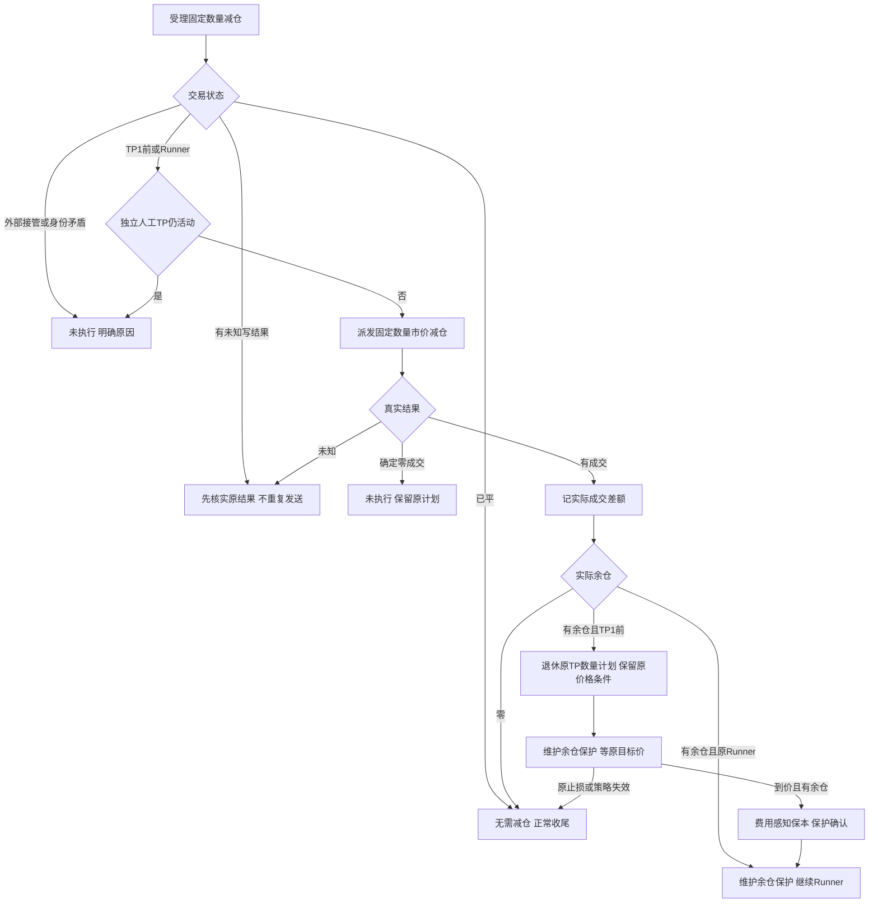

# 手机快速意图与自动续管设计

日期：2026-11-20。状态为**本地实现与验证阶段**。正式候选认证、真机和生产协议验收分别记录。

本设计覆盖手机交互、后台受理、命令派发、成交记账、TP／保本／Runner与收尾。基于本轮Owner决定，替换[原协作执行设计](2026-11-16-owner-cooperative-execution-v1.md)中的远程预览和执行前串行准备流程；保留人工减仓替代原TP减量、原目标价后自动续管的业务原则。设备绑定与签名基础沿用[手机详细设计](2026-11-16-mobile-owner-control-detailed-design.md)。生产身份和当前能力仍只由[主路线图](../../current/MAIN_CONTROL_ROADMAP.md)记录。

## 1. 目标、决定与证据边界

### 1.1 Owner已确认的目标

- 人工减仓是部分兑现或降低敞口，**不是退出原交易，也不是停止自动管理**。
- 手机：选择操作／输入参数→本地二次确认→发送→查看结果。不等待服务器生成预览，不赶预览倒计时。
- 百分比以页面展示的服务端仓位快照为基数：显示100、确认50%，冻结请求量50；后台不按新的余仓偷偷放大或重新解释该数量。
- 首版人工单次减仓上限为确认基数的50%；常规TP1不超过50%作为默认使用范围。既有冻结交易和人工TP计划不得因此被追溯改写。
- TP1前人工减仓替代原TP数量退出：撤原TP数量单，保留目标价，到价后为余仓建立保本并进入Runner；不新增等比缩TP机制。
- Runner中减仓继续原Runner，不重置阶段。只收紧止损，不加仓、不放宽保护、不提高资金或风险上限。
- 新指令须在受理后60秒内开始发送；未发送过期则结束，已开始／未知结果继续核实和收尾。

### 1.2 已知缺陷与本次必须处理的问题

| 编号 | 已确认问题 | 本次要求 |
| --- | --- | --- |
| D1 | TP1历史成交曾被无活动TP误清零 | 保留已确认历史，真实采集器到操作链回归 |
| D2 | API角色不能锁Aggregate，所有持仓受理失败 | 正式权限契约与安装检查持久化，不依赖临时授权；验证真实角色 |
| D3 | 全平前已撤TP，引用未退休，平仓后重复撤单使事务回滚 | 撤单事实退休引用，残单清理幂等，不能放开盲重发 |
| D4 | TP1_PENDING／过期未发TP阻断已有保护仓位的人工退出 | 减量与全平不依赖TP安装完成，处理旧指令后推进 |
| D5 | 人工TP全部成交后仍被当活动计划，阻断Runner减仓 | 按剩余目标与活动订单事实判断计划是否完成 |
| D6 | 已成交、待清理、未受理混为“待核实／失败” | 成交结果、管理状态、清理状态分别表达 |

来源：本线程生产只读取证与本地重放。详细本地证据位于`.local/mobile-operation-audit-20261120/`、`.local/owner-path-review-20261120/`；它们不作为运行时权威。正常路径的既有回归不能证明新快速路径已完成。

### 1.3 本稿工程选择及边界

采用“**快速持久受理，减量命令优先，成交后自动续管**”。不开放直接交易所HTTP写入口，不新建第二套生命周期、订单账本、worker或补偿系统。

“立即派发”指不等待远程预览、策略评分、TP安装和完整历史采集，不表示绕过账户身份、真实未知订单、当前运行围栏等硬门禁。缺失或矛盾事实不能被数据库旧数量替代；必要核实由后台自动完成，手机不追加确认。

## 2. 用户流程与操作输入

| 操作 | 冻结输入 | 后台规则 |
| --- | --- | --- |
| 减仓 | Ticket、基数快照版本/数量、固定请求量、比例（可选） | 向下按数量步长对齐；0＜Q≤基数×50%；不自动补足部分成交 |
| 本笔全平 | Ticket、结束该交易的意图 | 使用发送时可证实的该Ticket余仓；已平返回无需操作，不关闭之后的新Ticket |
| 收紧止损 | Ticket、固定价格 | 只收紧；系统已有更紧有效保护则无需操作 |
| 设置/修改人工TP | Ticket、价格、数量、被替换计划身份 | 普通限价，目标越价不静默立即成交，变更计划则拒绝旧意图 |
| 取消人工TP | Ticket、所见计划身份 | 只处理该计划未成交部分；不能取消随后创建的新计划 |
| 全局/策略启停 | 明确目标状态、范围、版本 | 设置目标状态，不执行“取反”；恢复仍检查现有门禁 |

页面快照用于表达Owner授权数量和目标，不作为交易所当前事实证明。服务端核验基数来源属于该Owner/Ticket，不能只信客户端自报100。仅行情变化、已记账减量不机械要求“版本完全相等”；更换Ticket、管理权转移、人工计划被替换等实质变化按具体原因终止。

确认页面展示固定数量、余仓自动管理及TP1前减仓将撤原TP的效果；不显示内部数据库/命令术语，不堆砌说明。取消75%快捷选项；服务端也执行50%约束，不能仅改按钮。

## 3. 受理与执行责任

### 3.1 短事务受理

1. 验证设备、签名、nonce、Owner/账户/Ticket和输入格式，查幂等回执。
2. 按统一顺序锁定Ticket与操作记录。权限通过窄范围锁函数或经验证的列级授权满足，不授予API整表业务写权限。锁等待有界。
3. 同Ticket重复请求同key返回原结果；不同key的等价在途全平返回原操作；其他不兼容人工操作返回已有操作编号，不创建多个待执行人工队列。
4. 原子保存授权意图、唯一operation、结果回执。退出指令可安全立即构造时，在同一事务创建唯一durable Command；否则标记后台准备，不宣称已经发送。
5. 提交事务即响应accepted；受理阶段不调用交易所，不依赖用户继续在线。

相同idempotency key但不同载荷拒绝；请求未知时前端保留原身份，只查询原结果，不自动换key。事务已证明回滚时返回明确未受理；进程断开导致提交结果不明时保持unknown，通过原回执核实。

### 3.2 调度与互斥

- 复用现有Lifecycle/命令dispatcher执行、Reconciliation核实与收尾，API不直接发交易所订单。
- 人工减量只串行同Ticket；不为此阻塞其他票的必要止损/退出。全局新ENTRY串行规则不变。
- 受理时唤醒或提高现有worker中该票优先级，不能等待多个普通低优先级轮询周期。
- 对原TP/Runner：尚未发送且冲突的指令可以原子退役；已经CLAIMED/发送中/未知结果不可当作未发送删除。必要保护持续有效。
- 不增加第二份状态真相；operation记录用户意图和进度，Command记录外部副作用，TradeEvent/Aggregate记录真实成交与管理阶段。

## 4. 减仓业务分支

### 4.1 正常优先顺序

具备已核实的全仓保护且没有活动TP时，后台读取一轮必要事实后即可生成固定数量的市价减仓命令。已有固定数量保护或活动TP时，在交易所交错行为得到直接证实前，后台先完成保护转换或原TP撤销，再派发减仓。原有保护在替代保护确认前继续生效。全平遇有活动TP时先核实撤单并退休订单引用，再发送退出。以上均由后台完成。

**快速路径协议前提必须先验证**：Binance Hedge下准确的BUY/SELL＋positionSide关闭指令、数量超过实际余仓时的返回行为、是否可能反向增仓。不能假设发送reduceOnly字段即可（当前Hedge适配不能照搬单向模式参数）。若协议不能证实该路径只减少目标仓位，则在后台追加一次有界仓位核实，或先解决已知冲突；不能以“不考虑准确性”绕过开反仓风险，也不能偷偷改变固定请求数量。

### 4.2 TP1前，零成交、部分成交和自然TP交错

| 情况 | 减仓与TP处理 | 续管状态 |
| --- | --- | --- |
| 人工减仓全部成交，原TP未成交 | 记实际减量；精确撤原TP；确认撤单并退休引用 | 有余仓则等待原目标价 |
| 人工市价单终结但只部分成交 | 记实际成交，不自动补剩余请求量；因已有人工减量，退休原TP数量计划 | 同上；手机明确实际成交少于请求 |
| 人工订单确定零成交 | 不因为“尝试过减仓”触发管理转换，保持原TP与阶段 | 未执行 |
| 原TP在人工发送前完整成交，事实已确认 | 已进入Runner且固定请求量可执行则按固定量减；否则拒绝该固定量请求，不擅自全平 | 以实际阶段为准 |
| 原TP部分成交 | 先按新累计量减旧累计量记账，人工成交另记；撤原TP残量 | 有人工成交时转原目标价条件；没有人工成交则原生命周期继续 |
| 原TP与人工减仓均成交 | 两笔成交分别去重，合计扣仓；不重复记同一成交 | 有余仓：满足目标价条件后保本；零仓：正常收尾 |
| 原TP撤销未知 | 已有人工成交照实展示；不宣称原TP已退休；保留精确订单待核实 | 管理调整中，不触发重复减量 |
| 原TP取消明确失败但仍活动 | 后台处理已知残单，不恢复已成交人工数量，不生成新的减仓 | 保护保留，明确待处理原因 |

零仓位不能走“TP必须留下Runner”的断言。100−50−50=0属于合法终态。多次减仓不等于累计永不超过50%；每次按当次确认基数约束，后台按实际余量守恒。

### 4.3 保留目标价的时序

人工成交不自动触发BE。目标价条件满足的证据从本次实际减仓执行时刻开始：有效实时成交价或该时刻之后精确证据，不能用减仓前历史K线高低点冒充。期间真实原TP成交可证明目标价曾到达，但必须与本次减仓的时序对应。

达到目标价，按真实余仓和可核实费用计算保本；不追偿已实现亏损。若当前价已越过拟设保本价，沿现有明确退出分支处理，不安装反向/放宽保护。保护确认及旧Stop处理完成才标记Runner可正常跟踪。

### 4.4 Runner与人工计划

Runner减仓保留break_even_floor、runner水印和适用退出规则，只更新余仓及保护覆盖。没有活动TP订单的历史成交量不归零。

独立人工TP仍有待成交量时，首版不隐式取消该Owner计划以执行减仓；明确提示先取消，不自动改价改量。**已完整成交的人工计划不属于活动计划**，不得再阻断减仓。计划的活动/完成/取消由订单及剩余目标事实派生，不能仅用cancelled=false判定。

## 5. 全平、保护和止盈的其他分支

| 操作/状态 | 必须行为 | 不允许行为 |
| --- | --- | --- |
| 全平遇TP1_PENDING | 尚未发送TP退役，已确认余仓走退出；必要Stop保留至平仓核实 | 因获利计划未安装而永久拒绝全平 |
| 全平遇另一退出在途 | 返回已有退出操作，核实结果 | 再发一笔相同全平 |
| 全平成交 | 立即显示真实退出量，独立清理TP/Stop残单 | 等Review完成才告诉用户已成交 |
| 收紧止损价格已被系统保护超越 | 核实已有更紧保护，返回已满足 | 安装更宽旧申请价 |
| 申请Stop已被当前价穿越 | 明确未执行，保留已有保护，原策略退出继续 | 等价格回头后复活旧意图 |
| 人工TP设置/修改目标被穿越 | 结束旧申请，保留已产生效果，明确重新操作 | 静默改成立即成交或无限等待 |
| 取消人工TP时发生部分成交 | 记已成交，只取消未成交量，余仓续管 | 将已成交数量加回仓位 |
| 取消人工TP已全部成交 | 返回已成交/无需取消，并让余仓进入适用阶段 | 永久占用操作，阻断Runner |
| 计划修改只完成撤旧单、发新单失败 | 显示旧TP已撤、新TP未建立；保护与原失败退出继续 | 宣称原计划未改变或自动恢复旧价 |
| 外部Binance App介入 | 按现有归属规则转MANUAL或REVIEW，停止未发送自动副作用 | 将未知归属伪造为Owner接管，或自动回AUTO |

## 6. 异常与恢复矩阵

| 异常 | 是否可自动继续 | 持久化/手机结果 |
| --- | --- | --- |
| 权限、Schema、运行身份不符 | 不发送；确定性错误不高频重试 | 失败原因、operation关联；未受理与已受理后失败分开 |
| 数据库事务提交结果未知 | 查原key回执 | 提交待核实，不创建新key |
| 交易所连接超时/断线 | 按原clientOrderId查询 | 交易结果待核实，不盲重发 |
| 交易所明确拒绝 | 结束该指令，不自动换数量或补单 | 未执行及具体原因；处理已发生的其他效果 |
| 指令未发送且超过60秒 | 确认无发送占用后退役 | 未执行：已超时；释放人工操作占用 |
| 已发送超过60秒 | 继续查原结果和管理保护 | 不把未知误判过期未执行 |
| Stop先触发／余仓变化 | 真实成交落账；未发送人工量不再适用则结束 | 原策略退出/数量变化；零仓正常收尾 |
| 部分成交 | 逐成交身份去重累计，终结后不补单 | 实际减量、余量和管理状态 |
| 撤单已成功又收到重复事件 | 幂等消费并退休引用 | 不产生第二次相同撤单 |
| 余仓保护无法确认 | 保留有效旧保护，按现有保护异常政策推进核实/退出 | 已成交＋保护待处理，不虚报Runner正常 |
| worker重启 | 读取同一operation/Command阶段恢复 | 不依赖手机在线，不丢未知结果 |
| 平仓后剩残单 | 精确namespace清理，确证零仓无单后释放预算/domain | 已平仓，后台收尾中 |
| 费用/资金费证据缺失 | 留缺项，允许独立补证据 | 不把缺失当零，不重发交易 |

操作队列不无限等待用户不再需要的行情。60秒限制首次交易发送，副作用已发生后必须完成核实/保护/清理，不能因超时丢弃责任。

## 7. 数据与状态契约

### 7.1 状态职责

沿用owner_position_operations及exchange_commands，扩展现有operation载荷或约束，**不建立平行表链**。状态名以实现迁移定义为准，业务含义固定如下：

- 受理：authorized intent已经持久化。
- 执行：至少一个关联Command待发送/在途。
- 成交：已验证实际成交量；与收尾状态正交。
- 管理调整：原TP退休、余仓Stop确认、阶段衔接尚未完成。
- 完成：有余仓且正常AUTO续管已证明，或零仓无残单完成收尾。
- 未执行：确认所有相关交易副作用未发生。
- 待核实：仍有未知结果，不能解锁后再发相同交易。

收紧/改止盈可能部分生效，不能统一标记“全部未执行”。结果至少包含requested_quantity、executed_quantity、remaining_quantity、execution_state、management_state、cleanup_state、reason、updated_at；读模型派生，不作为新交易权威。

### 7.2 守恒与幂等

- Ticket初始成交量 = 当前余仓 + 各类退出真实成交量之和（同一成交只计一次）。
- 人工减仓不写TakeProfitFilled；TP1计数按具体计划语义维护，换计划不能丢失历史成交证据。
- 成交事件、Aggregate变化、对应操作阶段更新在同一短事务中提交；事务外读取交易所。
- 原TP撤销完成应精确匹配namespace/orderId，退休活动引用；保留历史订单与成交，不删除审计。
- 各账户/币种/方向及Ticket身份严格隔离；旧请求不能作用于新Ticket。
- 余仓保护覆盖须由实际有效Stop证明，不能只赋protected_qty=position_qty。
- 减仓不立即释放整票预算；零仓但残单/未知结果未清不能声明终态。预算重估若现有机制支持则沿用，不在本次追加风险扩张。

## 8. 模块实施与退役范围

| 层 | 修改范围 | 删除/替换内容 |
| --- | --- | --- |
| 手机app.js | 本地确认、固定量、原操作回执与成交/收尾展示 | 远程预览轮询、30秒预览倒计时、75%快捷按钮 |
| mobile路由与operation仓储 | 直接签名意图受理、角色锁契约、等价全平去重 | 依赖preview_version的第二次受理前置 |
| operation推进/发送门 | 固定量快速Command、60秒启动限制、跨阶段退出 | 所有操作统一等待完整预览事实；过期原TP永久阻断 |
| Reducer/lifecycle | 原TP退休、实际成交守恒、BE/Runner、已完成计划判定 | 已撤订单重撤、完成计划被判活动 |
| Reconciliation/Review | 零仓残单幂等清理、实际经济归因 | 为绕过清理错误而依赖外部接管 |
| 部署与测试 | 持久权限、精确角色验证、整链故障验收 | 用管理员HTTP测试冒充生产角色通过 |

不保留两套“旧预览提交”和“新直接受理”长期并存。旧页面提交退役接口应明确要求刷新，不能解释为另一种交易。发布前处理已有未决operation与会话回执；涉及schema约束时采用当前批准的停止/平仓/前向保全流程，不设计活仓Schema交接。部署须另行授权，不能为上线而代用户平仓。

## 9. 测试与验收标准

### 9.1 分层验证

- 单元：业务分支、数量对齐、50%上限、状态转换、幂等与过期条件。
- 真实PG：使用独立可丢弃库、生产同类API角色；核对请求事务current_user，不能让SET ROLE回滚恢复管理员后假通过。
- 原始协议：真实格式的订单/成交/条件单父子身份、Hedge参数，GET与写边界记录；模拟响应不得隐藏真实生产字段。
- 整链：真实手机JS模拟输入→签名HTTP→受限角色受理→持久Command→原始协议适配→事实记账→管理阶段→对账/Review。
- 真机与生产：另列实测，不通过强制真实订单造样本；自然获批操作才形成真实成交验收。

### 9.2 必须通过的验收用例

| ID | 场景 | 可观察通过标准 |
| --- | --- | --- |
| A01 | 六类持仓操作真实权限 | 受理无权限异常，角色不是superuser；错误权限明确拒绝，不产生订单 |
| A02 | 100确认减50 | 发送量为50或合法步长向下对齐，不因之后页面刷新重算放大 |
| A03 | 50%边界/75%输入 | 50%允许；超过50%在前后端一致拒绝；无需交易所读取 |
| A04 | 重复确认、双页面、响应丢失 | 同意图只一条减量Command；回执可查询；不同key冲突可定位原操作 |
| A05 | TP前正常减仓 | 原TP数量退出退休，余仓受保护，目标价保留，tp1成交量未伪增 |
| A06 | 减仓后到目标价 | 只建立BE，不再次卖出；确认新Stop与旧Stop处理后进入Runner |
| A07 | BE后连续两轮Runner更新 | 不只返回move_requested；真实PG记录两轮独立保护订单确认、余仓一致 |
| A08 | 自然TP全部成交→Runner减仓 | 历史TP不归零，减仓后仍Runner，floor不放宽 |
| A09 | 人工TP全部成交→Runner减仓 | 已完成计划不再阻断；独立未成交人工计划仍明确拒绝混合操作 |
| A10 | 浮亏减仓 | 记真实亏损，不立即BE，不把余仓BE解释为整票回本 |
| A11 | 人工部分成交 | 仅扣实际量，重复回放不重复扣，无自动补足；保护覆盖实际余仓 |
| A12 | 原TP部分/全部成交交错 | 分别去重记账；100−50−50=0正常关闭，不触发必须留Runner异常 |
| A13 | Stop先触发/未知退出 | 不发重复退出，不增仓；核实后明确余仓或零仓 |
| A14 | TP1_PENDING和过期未发TP | 原未发送指令退役后可全平；在途未知不被当作未发送 |
| A15 | SOL历史故障复现 | TP撤成功→全平成交→Stop清理→结算；无重复撤TP、无CommandGenerationError |
| A16 | 断电/进程退出注入 | 受理后、发前、发后无响应、成交落账前后、撤单前后重启均不重复成交/丢状态 |
| A17 | 60秒过期 | 未发送结束；已发送/未知继续核实；不会在价格回头后复活旧指令 |
| A18 | 止损/TP越价、计划被替换 | 不放宽保护、不偷偷换价格、不取消新计划；准确返回实际效果 |
| A19 | 最终账务 | 入场量与所有退出量守恒；人工/TP/Stop各自归因；手续费不丢不重；缺项显式不可用 |
| A20 | 旧前端与新后端 | 明确刷新要求，旧确认不能意外提交成新语义；未决回执可查询 |
| A21 | 长会话/后台回收/网络恢复 | 页面关闭不影响已受理执行；恢复后显示同一操作、实际成交与收尾 |
| A22 | 正常保护、其他票并行 | 人工操作不阻塞其他票必要退出；原Owner范围/策略/资金上限不变 |

D1—D5必须先出现针对性的失败证据，再修复到通过。若原始协议不满足快速减量的只减仓前提，A02/A12/A13不得标PASS，应落实有界后台核实路径后重新验收。

### 9.3 性能与用户结果标准

以下为工程验收目标，不是生产SLA承诺：

- 本地/同机API不含外网的受理p95≤1秒；受理链交易所GET数为0。
- 健康条件下持久受理到首个交易指令发送p95≤2秒（测试调度和模拟传输可控）；超过阈值记录具体等待步骤。
- 首个交易发送不超过60秒；每个网络调用有超时；不把全历史读取放在快速发送前。
- 确认成交后一个客户端刷新周期内可见“实际成交”，不得等待结算或Review；后台变化自动刷新，无需反复点击刷新进度。
- 保护/清理未完成时持续展示实际状态，不以成交成功掩盖保护问题。
- 异常重试有界、退避且可诊断，不每500毫秒重复相同确定性错误，不污染账户Feed进度。

## 10. 完成定义与未决事项

完成要求：必要用例通过＋所有已确认缺陷闭合＋真实权限下整链证据＋精确候选认证；真机和自然实盘事实分别记录。文档、单元数量、模拟成交不能替代实盘验收。

业务默认本稿已明确，无需Owner决策代码锁/表结构/重试算法。以下属于实现前技术核验，负责人为工程，不转嫁给Owner：

1. Hedge关闭方向与超余仓数量的实际协议行为；未证明时不得用旧快照盲发。
2. TP和Stop交错的最短安全发送顺序及在途结果处理。
3. 旧operation状态和新受理载荷的前向迁移、旧前端失效处理。

若验证要求改变“固定数量、50%、人工减仓替代TP数量退出、60秒启动期限、默认AUTO续管”这些业务决定，再单独说明实际证据和取舍；不擅自改成比例重算或人工接管。
